# Official solution — dual-check

## Completion path at a glance

```
game.exe:
  recover Password 1 (static analysis)
    -> pass quiz (3 questions, answerable from the same analysis)
    -> win mini-game (target number is a visible literal)
    -> game.exe prints Password 2

checker.exe (independent binary):
  gate 1: Password 2 (from game.exe)
    -> gate 2: 16-byte hex value (computed, not extracted)
    -> checker.exe prints the flag
```

Tooling used: Ghidra (static analysis), Python 3 (reproducing extracted
logic). No dynamic debugging is required at any step.

## 0. Prepare a clean state

Import both binaries into a Ghidra project (`File → Import File` for
each; accept default analysis options). Since this lab has no server-side
state, there is nothing to reset between attempts — re-running either
binary, or re-opening the Ghidra project, is itself a clean start. See
"Reset and retest" below.

## 1. Recover Password 1 from `game.exe`

Decompiling `main()` shows the gate order:
`Password → verify_sys_integrity() → run_quiz() → run_mini_game() →
reveal_password_2()`.

In `verify_sys_integrity()`:

- `is_debugger_present()` is an anti-debug gate — a debugger attached
  makes the check fail silently with the same error message either way.
  This is a deliberate deterrent against dynamic analysis; it does not
  need to be defeated, since the intended path is entirely static.
- A masked string is XOR'd with `1` byte-by-byte. (Ghidra's decompiler
  view visually concatenates the real 20-byte mask with an adjacent
  string literal in `.rdata` — this is a decompiler display artifact,
  not real program behavior; only the first 20 bytes matter.)
- The unmasked result is Base64 text, decoded, then XOR'd with a 4-byte
  repeating key read directly from `.data` (`4B 33 79 21`, i.e. ASCII
  `"K3y!"`).

Reproduced in Python:

```python
import base64

masked = "NP@QDkm@Ro5l@B[SKvD<"
unmasked_b64 = ''.join(chr(ord(c) ^ 1) for c in masked)
decoded = base64.b64decode(unmasked_b64)

key = bytes([0x4B, 0x33, 0x79, 0x21])
password1 = bytes(b ^ key[i % 4] for i, b in enumerate(decoded)).decode()
print(password1)  # r3v3rs3_m3_pl2
```

**Password 1 = `r3v3rs3_m3_pl2`**

## 2. Pass the quiz

Answerable directly from step 1's analysis — no separate lookup needed:

| Question | Answer |
| --- | --- |
| How many distinct XOR key bytes are used? | `4` |
| What are the 4 bytes of the XOR key, in hex? | `4B 33 79 21` |
| What is the name of the function that verifies the password? | `verify_sys_integrity` |

## 3. Win the mini-game

A number-guessing round; the target (`7`) is a plain integer literal
visible directly in the decompiled `run_mini_game()`.

## 4. Recover Password 2

On success, `reveal_password_2()` runs and prints Password 2. It uses the
same XOR-mask + Base64 + repeating-key-XOR technique as Password 1, with
its own independent constants — so it is statically recoverable the same
way even without running the program interactively.

**Password 2 = `ch3ck3r_unl0ck_key`**

## 5. `checker.exe` gate 1 — the file password

`checker.exe` is fully independent of `game.exe` at runtime.
`check_password2()` hashes the input with SHA-256 and compares it to a
stored hash — the real password is never stored as plaintext. Enter
Password 2 from step 4.

## 6. `checker.exe` gate 2 — the computed hex value

The core of `checker.exe`'s own puzzle. Decompiling
`compute_check_value()`:

```c
void compute_check_value(longlong out) {
  byte prev = 0xa5;
  for (int i = 0; i < 0x10; i++) {
    byte b = CHECK_SEED[i] ^ prev;
    b = rotate_left(b, (i % 5) + 1);
    b ^= CHECK_CONST[i];
    b = b + i*3 + 7;
    prev = b;
    *(byte *)(i + out) = b;
  }
}
```

This is a chained (CBC-like) transform — each byte depends on the
previous byte's result, so it must be computed in order, not
independently per byte. `CHECK_SEED` and `CHECK_CONST` are both read
directly as raw bytes from the Listing view (16 bytes each).

Reproduced in Python:

```python
def rol8(x, n):
    x &= 0xFF
    return ((x << n) | (x >> (8 - n))) & 0xFF

CHECK_SEED  = [0x3f,0x8a,0x12,0xd4,0x67,0xe9,0x0b,0x55,
               0xc2,0x7a,0xf1,0x29,0x84,0x36,0xbd,0x5e]
CHECK_CONST = [0x11,0x2d,0x3c,0x44,0x58,0x61,0x79,0x82,
               0x93,0xa5,0xb6,0xc8,0xd9,0xe2,0xf3,0x07]

prev = 0xA5
out = []
for i in range(16):
    b = CHECK_SEED[i] ^ prev
    b = rol8(b, (i % 5) + 1)
    b ^= CHECK_CONST[i]
    b = (b + (i * 3 + 7)) & 0xFF
    out.append(b)
    prev = b

print(bytes(out).hex())
```

**Hex value = `2bb50ef99ea5dcea300e6efd3d8085e4`**

## 7. Flag derivation (performed by the program; independently reproducible)

Once both gates pass, `checker.exe`:

1. Folds the file password into a 16-byte key (`fold_password()` — every
   character affects the key, not just the first 16).
2. XORs that key with the submitted hex value → final AES-128 key.
3. AES-128-CBC-decrypts the embedded `FLAG_CIPHERTEXT` using that key
   and the fixed IV embedded in the binary.
4. Strips PKCS7 padding and prints the result.

This cannot be bypassed by static reading alone — the actual password
and hex value are required as runtime input. Once both are known,
though, the derivation can also be reproduced entirely offline (e.g. in
CyberChef's AES Decrypt operation, CBC mode, using the folded-key-XOR-hex
value as key and the embedded IV), which is a useful independent
cross-check that the chain's logic — not just the program's own runtime
behavior — produces the flag.

## Success criteria

Running the full solve end-to-end:

```
game.exe:
  Password: r3v3rs3_m3_pl2
  Quiz Q1:  4
  Quiz Q2:  4B 33 79 21
  Quiz Q3:  verify_sys_integrity
  Guess:    7
  -> prints password 2: ch3ck3r_unl0ck_key

checker.exe:
  Enter file password:           ch3ck3r_unl0ck_key
  Enter the recovered hex value: 2bb50ef99ea5dcea300e6efd3d8085e4
  -> FLAG printed
```

...and the printed flag's SHA-256 matches `lab.yml`'s `flag_hash`
(checkable directly with `check.py "<flag>"` at the lab root).

## Reset and retest

Not applicable in the usual sense — this lab has no server-side state,
no volume, and no per-player data. Both binaries are stateless console
programs; running either one again, with correct or incorrect input, is
always safe and always produces the same deterministic result. A
"reset" is simply re-running the executable.

---

## Full narrated walkthrough (with screenshots)

This section reproduces the challenge exactly as a participant would
experience it, with screenshots from an actual solve run. Screenshots
are in `images/`.

**Tools used:** Ghidra (static analysis), Python 3 (replicating
extracted logic). No dynamic debugging is required at any step.

### 1. Setup

1. Open Ghidra → `File → New Project` → Non-Shared Project.
2. `File → Import File` → import `game.exe`.

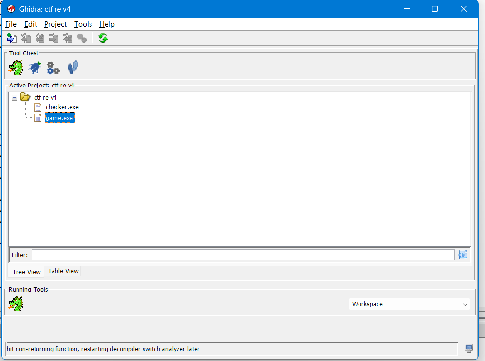

3. When prompted to analyze, accept with default options.

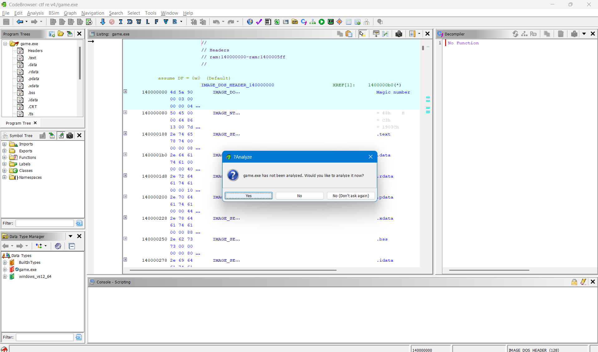

4. Repeat the same import + analyze for `checker.exe` (can be a second
   file in the same project).

### 2. Solving `game.exe`

#### 2.1 Program flow (`main()`)

Decompiling `main()` shows the gating order:

```
Password  →  verify_sys_integrity()
           →  run_quiz()
           →  run_mini_game()
           →  reveal_password_2()  (prints "password 2" on success)
```

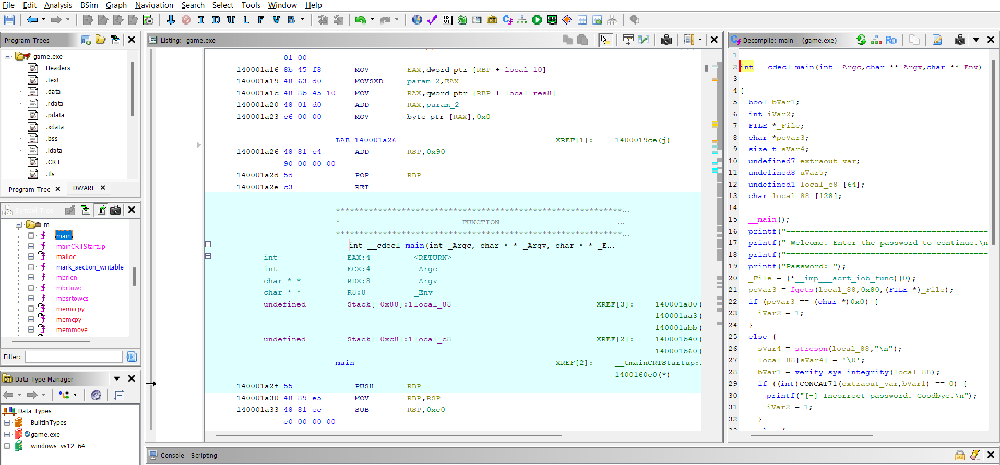

#### 2.2 Recovering Password 1 — `verify_sys_integrity()`

Decompile of `verify_sys_integrity()`:

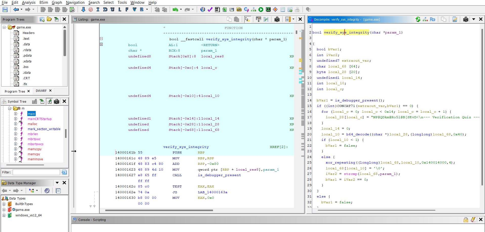

Key observations:

- `is_debugger_present()` — anti-debug gate. If a debugger is attached,
  the check always fails silently (same error message either way). This
  forces pure static analysis rather than step-through debugging.
- The masked string is XOR'd with `1` byte-by-byte. **Only the first 20
  bytes are real data** (`NP@QDkm@Ro5l@B[SKvD<`); Ghidra visually
  concatenates it with an adjacent string literal in `.rdata` — this is
  a decompiler display artifact, not real program behavior.
- After unmasking, the result is base64 text, which is base64-decoded,
  then XOR'd with a 4-byte repeating key stored at address
  `0x140014000`.

**Extracting the XOR key** — go to address `0x140014000` in the Listing
view:

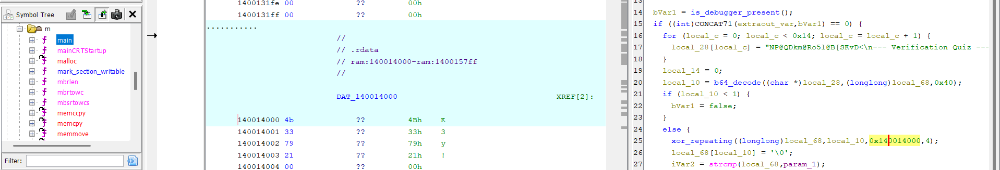

```
140014000: 4B 33 79 21        → "K3y!"
```

Reproducing the decode in Python (same snippet as "1. Recover Password
1" above). Or use CyberChef:

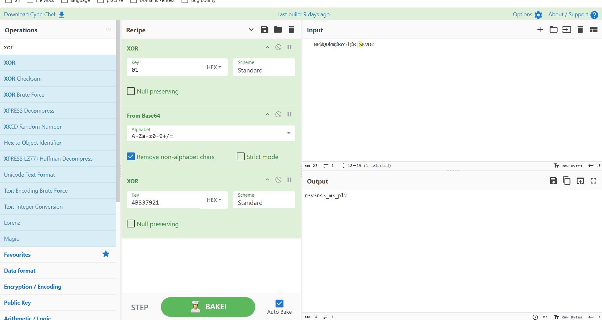

**Result: Password 1 = `r3v3rs3_m3_pl2`**

#### 2.3 Quiz

The quiz answers are discoverable directly from the static analysis
already performed (see the table in "2. Pass the quiz" above).

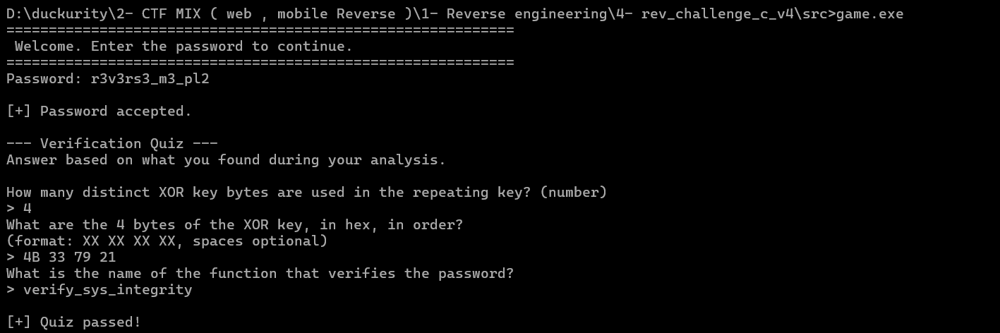

#### 2.4 Mini-game

A number-guessing game; the secret number (`7`) is a plain integer
literal visible directly in the decompiled `run_mini_game()`.

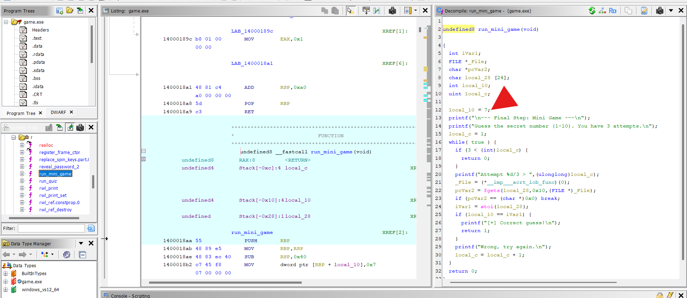

#### 2.5 Password 2

On success, `reveal_password_2()` runs and prints Password 2. It uses
the **same hide technique** as Password 1 (repeating-key XOR + base64 +
byte-masking) but with its own independent key/mask, so it is
statically recoverable the same way if desired — the program printing
it at runtime is just the fast path.

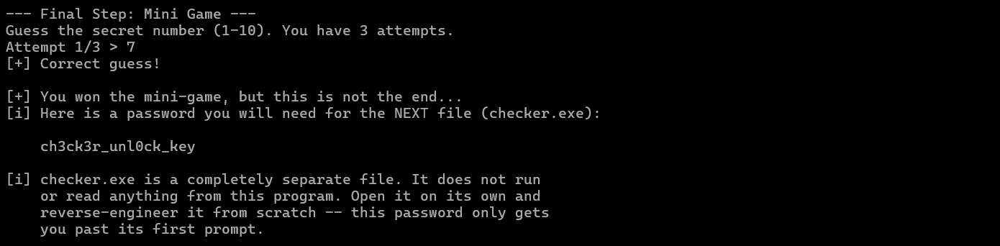

**Result: Password 2 = `ch3ck3r_unl0ck_key`**

### 3. Solving `checker.exe`

`checker.exe` is a **completely separate binary** — it does not read or
depend on `game.exe` at runtime. It requires two independently-verified
inputs before it will reveal anything.

#### 3.1 Program flow (`main()`)

```
Enter file password   → check_password2()         (SHA-256 hash comparison)
Enter recovered hex   → compute_check_value()      (must be computed, not extracted)
  → if both correct: derive final AES key, decrypt embedded ciphertext, print flag
```

#### 3.2 Gate 1 — the file password

`check_password2()` hashes the input with SHA-256 and compares it to a
stored hash — the real password string is never stored in the binary.
Because this value is *Password 2 from `game.exe`*, you must have
solved `game.exe` first.

**Value needed:** `ch3ck3r_unl0ck_key` (already obtained in 2.5 above).

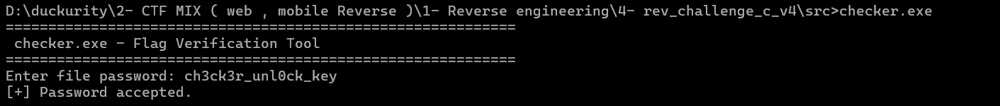

#### 3.3 Gate 2 — the computed hex value

This is the core of `checker.exe`'s own challenge — decompiling
`compute_check_value()` (see the C listing in "6. `checker.exe` gate 2"
above). This is a **chained transform** — each byte's result depends on
the previous byte's result (similar in spirit to CBC chaining), so it
must be computed in order, not independently per byte.

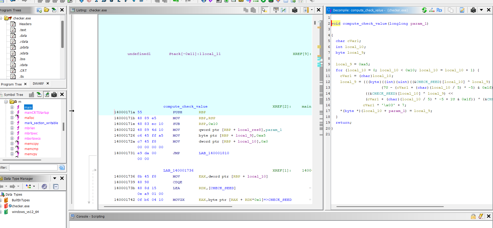

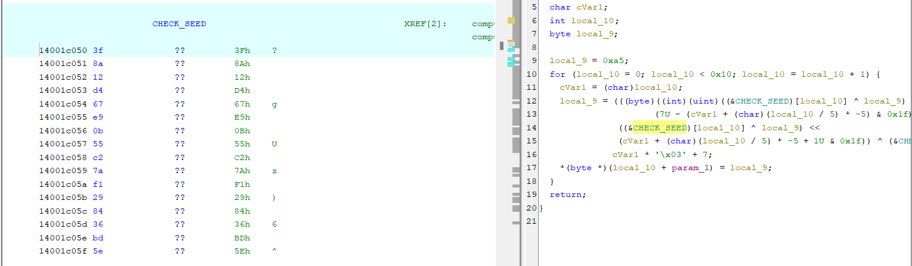

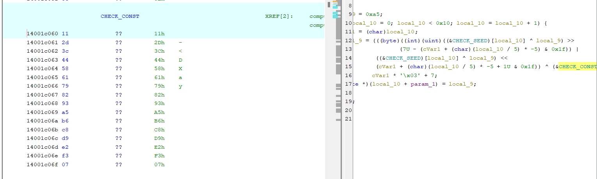

**Extracting the two constant arrays** from the Listing view:

```
CHECK_SEED  @ 0x14001c050:
3f 8a 12 d4 67 e9 0b 55 c2 7a f1 29 84 36 bd 5e

CHECK_CONST @ 0x14001c060:
11 2d 3c 44 58 61 79 82 93 a5 b6 c8 d9 e2 f3 07
```

Reproducing the transform in Python (same snippet as "6. Recover the
computed hex value" above).

**Result: hex value = `2bb50ef99ea5dcea300e6efd3d8085e4`**

#### 3.4 Deriving the flag (performed by the program after both gates pass)

Once both values are accepted, `checker.exe` internally:

1. Folds the file password into a 16-byte key (`fold_password()` —
   every character of the password affects the key, not just the first
   16 bytes).
2. XORs that 16-byte key with the submitted hex value → final AES-128
   key.
3. AES-128-CBC decrypts the embedded `FLAG_CIPHERTEXT` using that key
   and the fixed IV embedded in the binary.
4. Strips PKCS7 padding and sanity-checks the result looks like
   printable text ending in `}`.
5. Prints the flag.

This step cannot be bypassed by static reading alone — both the
password and the hex value must be correct. However, once both are
known, the final decryption can also be reproduced entirely outside the
program (e.g. CyberChef's AES Decrypt, CBC mode), confirming the
derivation is correct and not dependent on the program's runtime
behavior.

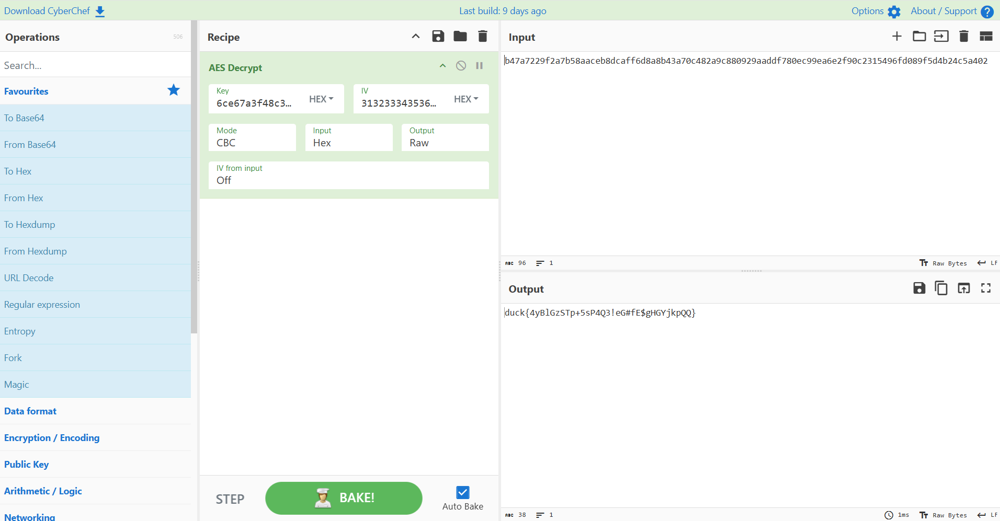

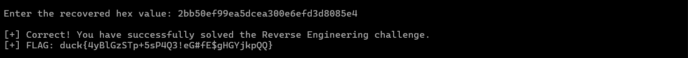

> **Note (screenshot provenance):** this solve run and its screenshots
> predate the current `lab.yml`'s `flag_hash`. The flag shown in these
> screenshots is from the **originally authored** flag
> (`duck{...}`), which was later found to
> violate the catalog's flag format (`^duck\{[a-z0-9_]{16,40}\}$` —
> lowercase/digits/underscore only; the original contained uppercase
> letters and the symbols `+ ! # $`) and was regenerated as a fully
> random, compliant flag. See `validation-report.mdx` for the fix and
> re-verification evidence. Every step above (the two passwords, the
> quiz, the mini-game, the chained-transform hex value
> `2bb50ef99ea5dcea300e6efd3d8085e4`) is unchanged and still exactly
> correct for the current binaries — only the final decrypted flag
> string differs. The current, correct flag's hash is recorded in
> `../lab.yml`; do not use the flag value shown in these screenshots as
> the expected answer.

### 4. Running the full solve

See "Success criteria" above for the exact input sequence against the
current binaries.
