> **Spoiler warning — maintainer/evaluator material.** This is the
> author's full solution. Do not distribute to players; see
> `../README.md` and `player-briefing.mdx` instead.

# Official solution — NexaWallet

## Chain summary

1. **Baseline:** Install the APK, register/log in, confirm the normal
   EGP 100 limit is enforced and a 500 transfer is declined.
2. **Static recon (jadx):** Decompile the APK. `TransferActivity.onCreate`
   shows the `IntegrityGate.isTampered()` redirect; the button handler
   shows `TransferAuthorizer.isTransferAllowed()` gating the over-limit
   path and `mintClearanceToken()` producing the flag text.
   `IntegrityGate.isTampered()` reveals three checks (Frida port probe,
   `/proc/self/maps` scan, thread-name scan). `TransferAuthorizer`
   reveals the second condition, `ReviewState.isCleared`, set only by
   `ReviewState.grantClearance(from: ReviewGateActivity)` with a
   liveness check on the passed instance.
3. **First hook attempt (intentional dead end):** Hook
   `IntegrityGate.isTampered()` directly and force `false`. The hook
   installs with no error, but the app still redirects to
   `RestrictedActivity`. Root cause: ART/JIT inlines the small function
   into its caller (`TransferActivity.onCreate`), leaving no call
   boundary for Frida to intercept.
4. **Pivot — framework-level hooking:** Hook the underlying framework
   calls instead: `java.net.Socket.connect()` (reject/skip the
   `27042` probe), `java.io.BufferedReader.readLine()` (filter lines
   containing `frida`/`linjector`/`xposed`), and `java.lang.Thread.getName()`
   (rename Frida's own threads before the scan sees them). See Part 2b
   below for the exact script.
5. **Gate 2 — find and reach `ReviewGateActivity`:** Text-search the
   decompiled project for `ReviewGateActivity`. It appears only in its
   own class definition and in the manifest as
   `android:exported="false"` — no other component references it, and
   `adb shell am start -n ...ReviewGateActivity` is refused by the OS.
   From inside the running (Frida-attached) process, obtain the app's own
   `Context` via `ActivityThread.currentApplication()` and call
   `startActivity()` on an `Intent` pointed at `ReviewGateActivity`. The
   hidden "Compliance Review" screen opens; tap **Approve**, which calls
   `ReviewState.grantClearance(this)`.
6. **Collect the flag:** Return to the Transfer screen, submit an
   over-limit amount again, and the UI displays
   `✅ Transfer approved beyond limit!` with the `duck{...}` token.

## Fully scripted variant

A single Frida script can drive the entire chain with no manual UI
interaction, using `Java.choose("com.example.nexawallet.ui.ReviewGateActivity", ...)`
to grab the live instance Android creates after `startActivity()` and call
`grantClearance()` on it directly, then similarly `Java.choose()` on
`TransferActivity` to invoke the transfer logic (or `performClick()` on
the confirm button). See "Optional — a fully scripted, one-shot solve"
at the end of this file.

## Flag

```
duck{...}
```

`flag_hash` (SHA-256, matches `../lab.yml`):
`17166ae75476ab1231632df6a4e7d3648d7f2d9453839e885f576eebc4dfd4eb`

## A known, accepted shortcut

A sufficiently determined static reader who locates
`TransferAuthorizer.ENCODED_FLAG` and its XOR key can decode the flag
offline without ever running the app or touching either gate. This is a
documented, accepted trade-off of making the flag fixed (required by the
catalog's single `flag_hash` field) rather than a bug — see
`challenge-design.mdx`, "Why the flag design changed during review," and
`validation-report.mdx`. It does not appear in the intended/taught solve
path above, and evaluators should not treat finding it as evidence the
intended chain is unnecessary.

---

## Full narrated walkthrough (with screenshots)

This section reproduces the challenge exactly as a participant would
experience it: install the APK, poke at it manually first, decompile it,
hit a dead end, figure out *why*, pivot, and chain the two gates to reach
the flag. Screenshots are in `images/`.

Tools used: an Android emulator (Pixel 6, API 29/34), `adb`, **jadx-gui**,
and **Frida** — pinned to `frida-tools 17.22.0` on the host and
`frida-server-17.22.0-android-x86` on the device (see `operations.mdx`'s
BYOD matrix for the pinned pair and why `-x86` was used here).

### Part 0 — Get the app running

Start the emulator from Android Studio:

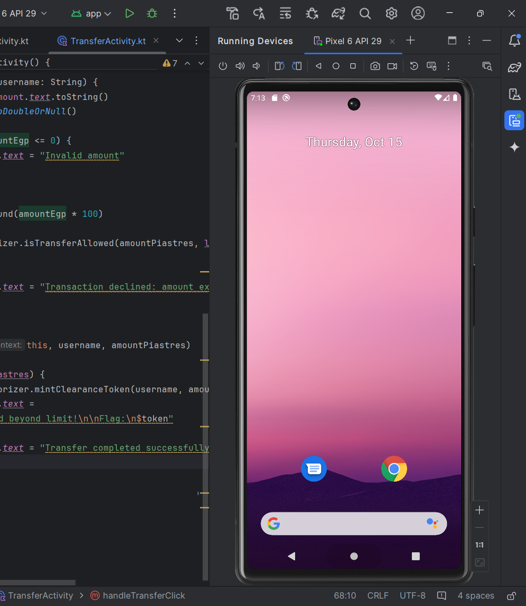

Check it's up:

```
adb devices
```

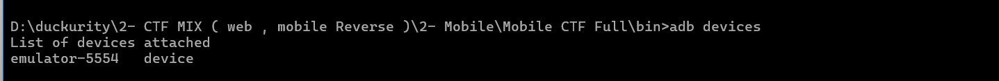

Install the APK:

```
adb install -r NexaWallet-debug.apk
```

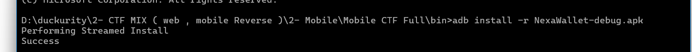

Open the app, register a new account, log in, and go to the **Transfer**
screen. It shows the limit up front:

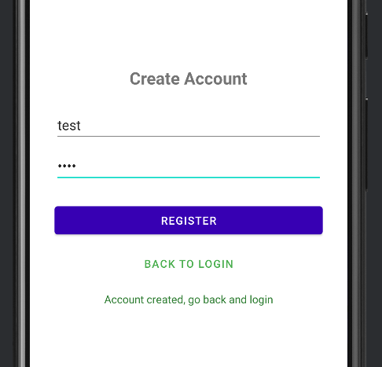

> Max transfer limit: EGP 100.00

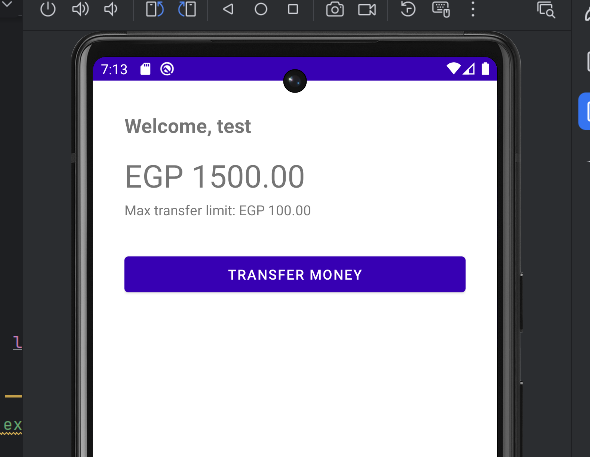

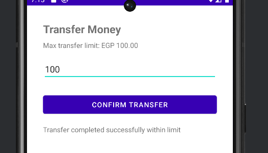

Try transferring **500**. It gets rejected immediately:

> Transaction declined: amount exceeds allowed limit

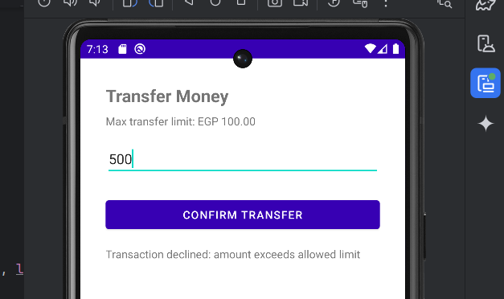

So the limit is real and enforced somewhere in the app. Time to look
under the hood.

### Part 1 — Static analysis with jadx

Open the APK in **jadx-gui**:

```
jadx-gui NexaWallet-debug.apk
```

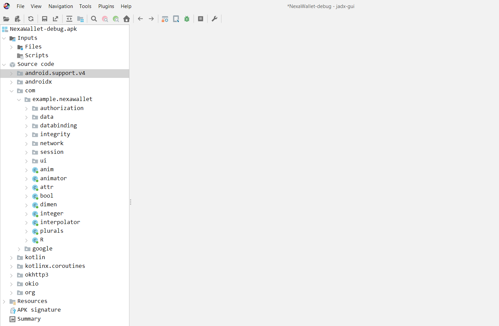

The package layout is self-descriptive:

```
com.example.nexawallet
├── ui/              TransferActivity, LoginActivity, HomeActivity, ReviewGateActivity, RestrictedActivity, ...
├── integrity/        IntegrityGate
├── authorization/     TransferAuthorizer, ReviewState
├── session/           UserSession
├── data/              LocalLedger
└── network/           PinningConfig, WebViewTrustManager
```

Open **`TransferActivity`**. Its `onCreate` is short and tells you almost
everything you need:

```kotlin
override fun onCreate(savedInstanceState: Bundle?) {
    super.onCreate(savedInstanceState)
    ...
    if (IntegrityGate.isTampered()) {
        startActivity(Intent(this, RestrictedActivity::class.java))
        finish()
        return
    }
    ...
}
```

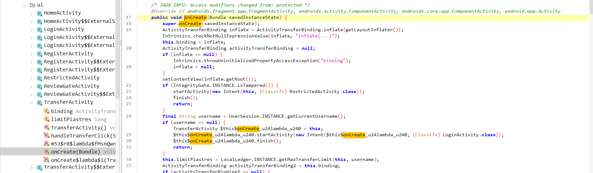

and further down, inside the button handler:

```kotlin
val allowed = TransferAuthorizer.isTransferAllowed(amountPiastres, limitPiastres)
if (!allowed) {
    binding.tvTransferResult.text = "Transaction declined: amount exceeds allowed limit"
    return
}
...
if (amountPiastres > limitPiastres) {
    val token = TransferAuthorizer.mintClearanceToken(username, amountPiastres)
    binding.tvTransferResult.text = "✅ Transfer approved beyond limit!\n\nToken:\n$token"
}
```

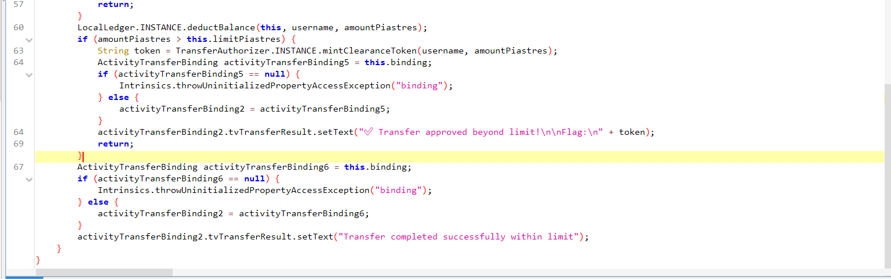

So there are two things standing in the way, confirmed directly from the
decompiled code:

1. `IntegrityGate.isTampered()` — if this is `true`, you get redirected
   before you even see the Transfer screen.
2. `TransferAuthorizer.isTransferAllowed(amount, limit)` — this is the
   real gatekeeper for the over-limit case.

Open **`IntegrityGate`**:

```kotlin
fun isTampered(): Boolean {
    return isFridaPortOpen() || hasInjectedLibrarySignature() || hasSuspiciousThreads()
}
```

Three independent checks: a loopback socket probe on port `27042`
(Frida's default), a scan of `/proc/self/maps` for known injected-library
name fragments, and a scan of live thread names for Frida's own runtime
thread names (`gum-js-loop`, `gmain`, `gdbus`, `frida`).

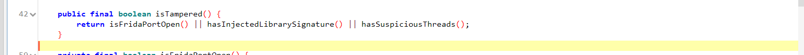

Open **`TransferAuthorizer`**:

```kotlin
fun isTransferAllowed(requestedAmount: Long, limit: Long): Boolean {
    return requestedAmount <= limit || ReviewState.isCleared
}
```

So an over-limit transfer is allowed only if `ReviewState.isCleared` is
`true`. Open **`ReviewState`**:

```kotlin
object ReviewState {
    private var cleared: Boolean = false
    val isCleared: Boolean get() = cleared

    fun grantClearance(from: ReviewGateActivity) {
        if (!from.isFinishing && !from.isDestroyed) {
            cleared = true
        }
    }
}
```

`grantClearance()` requires an actual **live** `ReviewGateActivity`
instance — not just a boolean flip from anywhere. That's the second
gate. Keep this class name in mind; it matters in Part 3.

### Part 2 — Defeating Gate 1 (IntegrityGate), and the dead end

The obvious first move: hook `IntegrityGate.isTampered()` directly and
force it to return `false`.

After turning on Frida, the app blocks access:

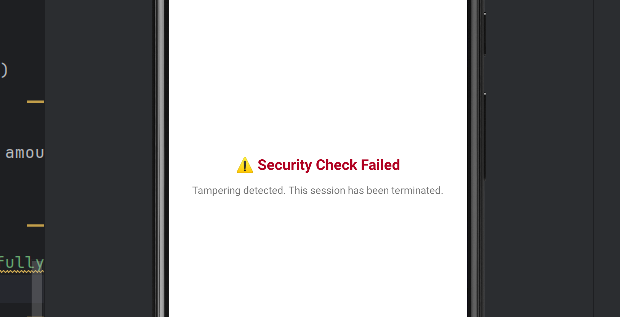

Push the pinned `frida-server` build matching the emulator's ABI (x86
here — `adb shell getprop ro.product.cpu.abi`):

```
adb push frida-server-17.22.0-android-x86 /data/local/tmp/frida-server
adb shell chmod 755 /data/local/tmp/frida-server
```

```jsx
Java.perform(function () {
    var IntegrityGate = Java.use("com.example.nexawallet.integrity.IntegrityGate");
    IntegrityGate.isTampered.implementation = function () {
        console.log("[Gate 1 bypass] isTampered() -> forcing false");
        return false;
    };
    console.log("[+] Gate 1 hooked.");
});
```

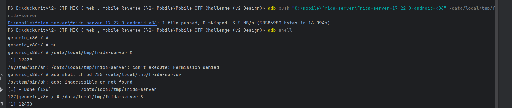

```
adb shell am force-stop com.example.nexawallet
frida -U -f com.example.nexawallet -l bypass.js
```

The hook installs cleanly — `[+] Gate 1 hooked.` prints with no errors.
But opening the Transfer screen **still** redirects straight to
`RestrictedActivity`:

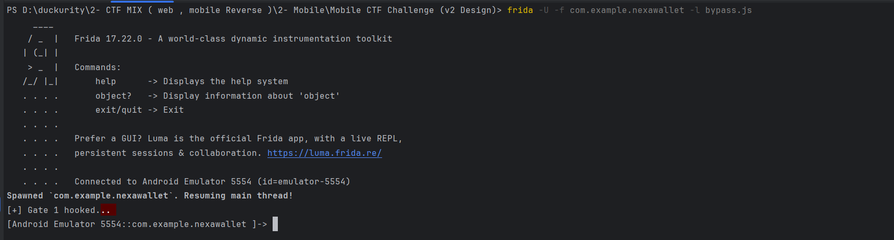


This is the first real obstacle in the challenge. The hook is
registered, so why is the decision still "tampered"? Adding a one-line
debug log directly after the call
(`Log.d("Debug", "isTampered() returned: $result")`) and watching `adb
logcat` confirms the method is still evaluating to `true` **at the call
site inside `TransferActivity`**, completely unaffected by the Frida
hook sitting on the same-named method.

**Why this happens:** `isTampered()` is a small, simple function with no
side effects of its own at its own call boundary — the kind of method
the Android Runtime's ahead-of-time/JIT compiler is free to **inline**
directly into its caller (`TransferActivity.onCreate`) once the app has
run a few times (or immediately, depending on the compilation mode).
Once inlined, there is no longer an actual method call at runtime for
Frida to intercept — the three checks' logic has effectively been
copied in place, so overriding the `IntegrityGate.isTampered` method
object does nothing: the code that runs no longer goes through it.

*(This can be confirmed/forced explicitly with `adb shell cmd package
compile -m interpret-only -f com.example.nexawallet`, which disables
ahead-of-time optimization — but even then the same mismatch persists,
pointing to a second, independent JIT-level inlining pass at runtime.)*

### Part 2b — The actual fix: hook one level deeper

The three checks inside `IntegrityGate` are built on standard
Android/Java framework calls:

- `isFridaPortOpen()` → `java.net.Socket.connect(...)`
- `hasInjectedLibrarySignature()` → `java.io.BufferedReader.readLine()`
- `hasSuspiciousThreads()` → `java.lang.Thread.getName()`

These are large, heavily-used **framework** methods — not small
single-call-site app code — so they are not inlined away the same way.
Hooking *them* instead of the app's own wrapper function works
regardless of what the compiler does to `IntegrityGate.isTampered()`
itself:

```jsx
Java.perform(function () {

    var Socket = Java.use("java.net.Socket");
    Socket.connect.overload("java.net.SocketAddress", "int").implementation = function (addr, timeout) {
        if (addr.toString().indexOf("27042") !== -1) {
            throw Java.use("java.io.IOException").$new("blocked by hook");
        }
        return this.connect(addr, timeout);
    };

    var BufferedReader = Java.use("java.io.BufferedReader");
    BufferedReader.readLine.overload().implementation = function () {
        var line = this.readLine();
        while (line !== null) {
            var lower = line.toLowerCase();
            if (lower.indexOf("frida") !== -1 || lower.indexOf("linjector") !== -1 || lower.indexOf("xposed") !== -1) {
                line = this.readLine();
                continue;
            }
            break;
        }
        return line;
    };

    // Gate 1 — suspicious Frida thread names
    var Thread = Java.use("java.lang.Thread");
    Thread.getName.implementation = function () {
        var name = this.getName();
        if (name !== null) {
            var lower = name.toLowerCase();
            if (["gum-js-loop", "gmain", "gdbus", "frida"].some(k => lower.indexOf(k) !== -1)) {
                return "RenamedThread";
            }
        }
        return name;
    };

    console.log("[+] Gate 1 hooked at the framework level.");
});
```

```
adb shell am force-stop com.example.nexawallet
frida -U -f com.example.nexawallet -l bypass.js
```

Now log in and open Transfer — it loads normally, with Frida attached:

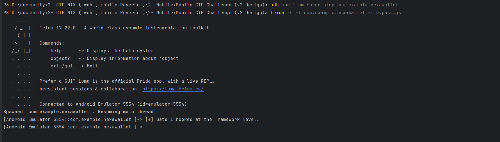

After running the script, the block is bypassed and the Transfer
interface is reachable:

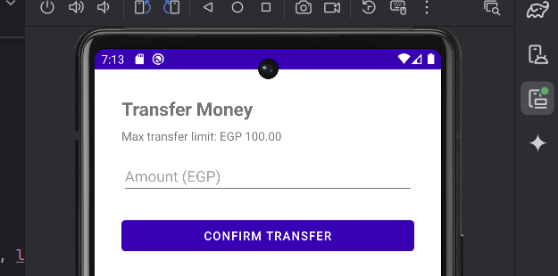

Gate 1 is defeated. Trying 500 again still gets declined, though — as
expected, since `TransferAuthorizer` has a second, independent
condition.

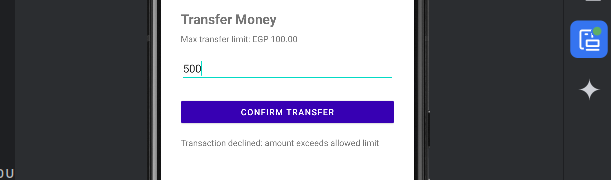

### Part 3 — Finding and reaching Gate 2 (ReviewGateActivity)

Back in jadx, search the whole project for **`ReviewGateActivity`**:

It turns up in exactly two places:

1. Its own class definition (`ui/ReviewGateActivity.kt`) — a small
   activity with an "Approve" button that calls
   `ReviewState.grantClearance(this)`.
2. `AndroidManifest.xml`:

   ```xml
   <activity android:name=".ui.ReviewGateActivity" android:exported="false" />
   ```

Nowhere else. No other `Activity` in the app ever constructs an
`Intent` pointing at it, and there's no button or menu item anywhere in
the UI that leads to it. `exported="false"` additionally means it
**cannot** be launched externally either — `adb shell am start -n
com.example.nexawallet/.ui.ReviewGateActivity` is refused by the OS
with a permission denial.

The only way left to reach it is from **inside the running process
itself** — which Frida can do, using the app's own `Context` to call
`startActivity()`:

```jsx
Java.perform(function () {
    var ActivityThread = Java.use("android.app.ActivityThread");
    var app = ActivityThread.currentApplication();
    var Intent = Java.use("android.content.Intent");
    var intent = Intent.$new();
    intent.setClassName("com.example.nexawallet", "com.example.nexawallet.ui.ReviewGateActivity");
    intent.addFlags(0x10000000); // FLAG_ACTIVITY_NEW_TASK
    app.startActivity(intent);
});
```

Paste this into the same Frida REPL session (the one already attached
from Part 2b, with Gate 1 still hooked) while the app is open on the
Transfer screen, and press Enter.

The hidden **"Compliance Review"** screen opens on top of the app:

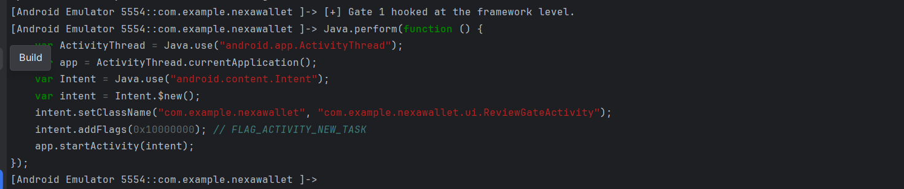

Tap **Approve**:

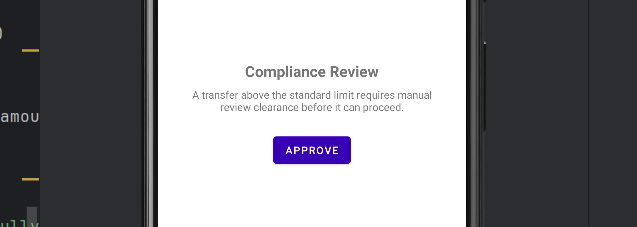

### Part 4 — Collecting the flag

Go back to the Transfer screen (back button), enter an amount above the
limit again (e.g. **500**), and tap **Confirm Transfer**:

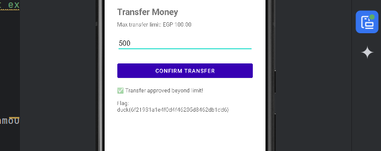

```
✅ Transfer approved beyond limit!

flag:
duck{...}
```

> **Note (post-fix):** this screenshot was captured against a build from
> before the flag-minting logic was fixed (see `challenge-design.mdx`,
> "Why the flag design changed during review"). At the time,
> `mintClearanceToken()` derived the flag from the player's username,
> amount, and a wall-clock timestamp bucket, so the exact value shown
> above (`duck{...}`) is specific to that
> run and differs from the flag a freshly built APK now mints. The chain
> of steps above (Parts 0–4) is otherwise unaffected — the fix only
> changed what `mintClearanceToken()` returns, not when it's called or
> what has to happen to reach it. The current, fixed flag and its hash
> are given above in "Flag" and recorded in `../lab.yml`;
> `bin/NexaWallet-debug.apk` in this repo was rebuilt from the current
> source to actually produce that flag — see `validation-report.mdx`.

### Optional — a fully scripted, one-shot solve

Everything above can be chained into a single Frida script with no
manual UI interaction at all, for a participant comfortable with
`Java.choose()`:

- Install the Part 2b hooks as shown.
- After spawning/launching the app and calling `startActivity()` on
  `ReviewGateActivity`, use
  `Java.choose("com.example.nexawallet.ui.ReviewGateActivity", { onMatch: function(instance) { ReviewState.grantClearance(instance); } })`
  to grab the **live** instance Android just created and call
  `grantClearance()` on it directly — satisfying the "not
  finishing/destroyed" check without ever tapping the on-screen button.
- Similarly, `Java.choose()` on `TransferActivity` to grab its live
  instance and invoke the transfer logic directly, or simulate the
  button tap via `performClick()`.

This doesn't change what's being defeated conceptually — the same two
gates, in the same order — it just demonstrates that a sufficiently
comfortable Frida user can automate the entire chain end-to-end.
