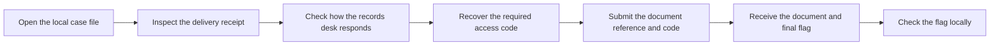
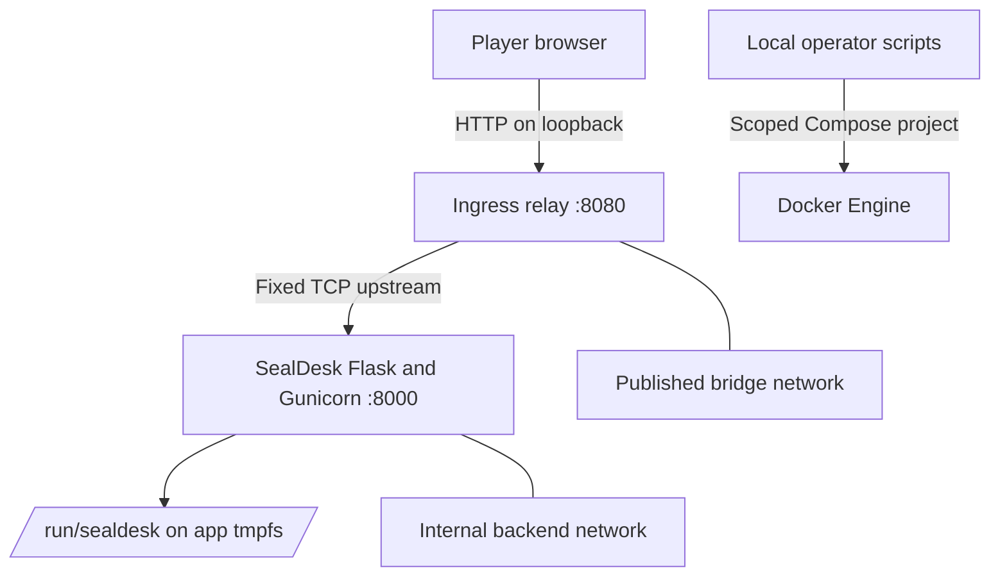

  <strong>Created by Ziad Osama El-Boshy</strong> 
  Challenge author and creator

# Challenge design

**SealDesk · Designer and evaluator edition · Updated 25 October 2026**

> **Current state:** SealDesk passes the recorded 41-test suite, 25-gate live lifecycle, clean-export Windows and WSL runs, selected repository checks, and a read-only source review. The author-run playtest passed on 25 October 2026. The author approved difficulty `medium`; this playtest is not an independent playtest or independent difficulty calibration. Hosted CI and maintainer review remain pending. See the [validation report](validation-report.mdx) for evidence and limits.

[Design brief](#design-brief) · [Learning objective and story](#learning-objective-and-story) · [Player journey](#player-journey) · [Architecture and trust boundaries](#architecture-and-trust-boundaries) · [Implementation contract](#implementation-contract) · [Runtime state and reset](#runtime-state-and-reset) · [Difficulty and design decisions](#difficulty-and-design-decisions) · [Guardrails and maintenance](#guardrails-and-maintenance)

## Design brief

| Attribute | Decision |
|---|---|
| Name | SealDesk |
| Track and difficulty | Crypto · `medium`, approved by the author |
| Scenario | A local records desk accepts an access code before releasing a fictional document. |
| Primary weakness | A deterministic AES-CBC PKCS#7 padding oracle caused by authentication after unpadding. |
| Player interface | Workbench at `http://127.0.0.1:8080/`, with a receipt check and a separate document form. |
| Required result | Recover the independently generated code, open the document, and submit the returned flag to the local checker. |
| Challenge mechanics | One receipt-check oracle, one separate document-open check, and one final flag. There is no checkpoint. |
| Runtime | Two Compose services, one loopback-published relay, and app state held on tmpfs. |
| Calibration status | The author approved `medium` after an author-run playtest. The result is not independent difficulty calibration. |

## Learning objective and story

Harbor Office Records prepared a sealed continuity plan for recipient Mara Chen. A case file provides a versioned delivery receipt. The document remains held until the desk receives the correct access code through a separate action.

The challenge demonstrates how a response can disclose PKCS#7 padding validity when an application decrypts unauthenticated CBC ciphertext and unpads it before checking an authentication tag. The receipt uses AES-CBC and an independently keyed HMAC. The intended order is bounded parsing, decryption, unpadding, HMAC verification, and plaintext discard. Invalid padding and padding-valid but unauthenticated ciphertext receive distinct response classes. The receipt endpoint never returns plaintext.[1]

The player recovers the code that unlocks the separate document operation. The HMAC is not a forgery target. No hidden account, external victim, timing signal, arbitrary endpoint, or host action is part of the intended solve. The document-open operation verifies the fixed document identifier and exact server-side code. A successful receipt check alone does not authorize document access.

## Player journey

| Stage | Player-visible evidence | Design boundary |
|---|---|---|
| Inspect the case | The workbench and `GET /case` expose synthetic case fields and a receipt. | Neither response includes the code, keys, or flag. |
| Check the receipt | The original receipt and bounded modified variants produce defined response classes. | The endpoint returns status and a message only. It never returns decrypted bytes. |
| Recover the code | The player varies a preceding CBC block or the IV and interprets the response. | No timing measurement, key recovery, or external request is needed. |
| Open the document | The player submits the fixed document identifier and recovered code. | Receipt validation is separate from document authorization. |
| Check completion | The local checker compares the returned flag with synchronized metadata. | The checker is local. The application does not call it. |

The UI presents the case and receipt first, then two distinct forms for receipt check and document open. It does not name the attack or disclose the solve path.

## Architecture and trust boundaries

| Component or boundary | Data and authority | Deliberate exception or limit |
|---|---|---|
| Player to ingress | HTTP reaches the loopback endpoint `127.0.0.1:8080`. | Ingress does not inspect HTTP or authenticate clients. |
| Ingress to app | A fixed TCP connection forwards to `sealdesk:8000`. | The relay does not accept a client-selected destination. |
| App to runtime state | Keys, access code, flag, receipt, and generation identifier are stored under `/run/sealdesk` on app tmpfs. | The app intentionally exposes receipt padding validity. |
| Receipt endpoint | The app parses a bounded receipt, decrypts it, removes padding, then verifies HMAC. | The differing padding and authentication responses are the sole intended vulnerability. |
| Document endpoint | The app compares the exact document identifier and code with runtime state. | A prior receipt response grants no document access. |
| Operator to runtime | `reset.py` and the synchronizer perform scoped local lifecycle and digest operations. | Operator helpers are not HTTP routes or player capabilities. |

Compose defines two services. `sealdesk` runs Flask and Gunicorn on port `8000`. It joins only the internal bridge network `sealdesk_default` and publishes no port. `ingress` is an asyncio TCP relay with a fixed upstream, a 64-connection semaphore, a 3-second connect timeout, and a 30-second idle timeout. It joins `sealdesk_default` and bridge network `sealdesk_ingress`. Only ingress publishes `127.0.0.1:8080:8000`.

Both services run as `10001:10001`. Both use a read-only root filesystem, drop all capabilities, enable `no-new-privileges`, and use an init process. Compose sets bounded tmpfs, PID, memory, CPU, and log limits. The app's backend network is internal. Runtime state is written with mode `0600` and owner `10001`. The ingress network is a normal bridge for host port publication. These controls reduce exposure. They do not establish general Docker host or kernel security.

## Implementation contract

| Interface | Request and response contract |
|---|---|
| `GET /` | Serves the case workbench and editable receipt field. |
| `GET /health` | Returns `{"service":"sealdesk","status":"ok"}`. |
| `GET /case` | Returns synthetic case data and the receipt, not the access code, keys, or flag. |
| `POST /api/receipts/check` | Accepts exactly `version`, `iv`, `ciphertext`, and `tag`. Invalid padding returns `422` with `damaged_envelope`. Valid padding followed by invalid HMAC returns `422` with `untrusted_envelope`. An authentic receipt returns `200` with `valid_receipt`. No response contains plaintext. |
| `POST /api/documents/open` | Accepts exactly `document_id` and `access_code`. A correct pair returns the fictional document and current flag. Invalid input returns the generic `403` document-unavailable response. |
| Local flag checker | Compares the submitted flag with the synchronized SHA-256 digest in `lab.yml`. The application does not call the checker. |

The receipt version is `SDR1`. IV and ciphertext use canonical unpadded Base64URL. The IV decodes to 16 bytes. Ciphertext is non-empty, no larger than 256 bytes, and block-aligned. A one-block ciphertext is accepted. The tag decodes to 32 bytes. The HMAC-SHA-256 input uses length-delimited version, IV, and ciphertext fields. The encryption and MAC keys are separate 32-byte values. The intended leak is the padding decision before HMAC rejection, not HMAC forgery.[1]

The plaintext frame is `SDR1|CASE-4107|<32 lowercase hexadecimal characters>`. The fixed document identifier is `CASE-4107`. The access code is generated separately and compared against server-side state. Recovering the code is sufficient to open the document. The shipped reference solver reconstructs the framed plaintext, validates the marker and identifier, and checks the code format. It does not derive either key.

The receipt parser rejects missing or extra fields, unsupported versions, non-canonical encodings, a wrong IV or tag length, empty or oversized ciphertext, and ciphertext that is not block-aligned. Malformed JSON or receipt framing returns `400` with `invalid_receipt`. Requests above the Flask `8 KiB` body limit return `413`. These are format and size checks, not oracle observations.

## Runtime state and reset

A fresh app container creates a generation identifier, code, flag, encryption key, and MAC key. The receipt is created from the framed code. The app serializes these values to `/run/sealdesk/instance.json` on its tmpfs with restrictive directory and file modes. The state file exists only while the app container runs. A Gunicorn worker restart inside the running container loads the existing file. Stopping, restarting, or recreating the app container clears its tmpfs, so the next start creates a new state file and a new instance.

`python scripts/sync_flag_hash.py` verifies the SealDesk stack. Its host-side helper receives only the current checker digest from the app-side state command and updates only `flag_hash` in `lab.yml`. The state command reads and validates private state to compute the digest, but emits no plaintext flag, access code, or keys.

`python reset.py` verifies the local Docker context and the identity and hardening of both containers and both networks. It refuses a stale checker digest. It stops ingress, recreates only the app without building or pulling, waits for app health, reads the new digest, updates `lab.yml`, restarts ingress, and verifies health through the relay and stack identity. The reset helper attempts to stop ingress if a later step fails. That cleanup is best-effort.

The committed `lab.yml` contains the last synchronized instance digest. After every start or container restart, run `python scripts/sync_flag_hash.py` before a manual checker run. Reset updates the digest itself. Do not restore a placeholder or retain runtime secrets in repository files.

## Difficulty and design decisions

The author reported that a fresh start from the player README, flag-digest synchronization, a solve with checker acceptance, and reset with the old flag rejected all passed. No ambiguity or unintended path was reported. The author approved difficulty `medium`.

The intended path requires the player to identify an observable response distinction, understand how the preceding CBC block affects plaintext, recover the code, and use the separate document operation. HTTP request handling, block-cipher familiarity, and basic scripting are useful. The solve does not rely on timing. Logged full solves took 81.0 to 161.5 seconds across the retained live and export runs. This observation is not a difficulty measure.

The application source and evaluator materials are present in the public training repository. The player README's scope rule does not technically prevent source inspection. A repository checkout is not source-blind material. The author-run result is evidence that the implementation and instructions worked for the author. It does not establish an independent learner's experience.

## Guardrails and maintenance

- Keep the padding oracle as the sole intentional vulnerability. Do not add timing variation, unrelated vulnerabilities, account logic, external targets, or source-dependent guessing.
- Keep receipt parsing bounded and canonical. Do not compare a submitted receipt with the stored original before the intended padding check.
- Do not return or log decrypted plaintext, access codes, keys, flags, or full runtime state. Synchronize only the checker digest.
- Treat Compose resources as SealDesk-owned only when their labels, ports, networks, mounts, identities, and runtime controls match.
- Keep maintainer solution content out of the player README and workbench.
- Update the route contract, tests, operations, security report, remediation guidance, and validation evidence together when observable behavior changes.
- Keep the distinction between an author-run playtest and independent difficulty calibration in every release record.

## Sources

[1] https://owasp.org/www-project-web-security-testing-guide/stable/4-Web_Application_Security_Testing/09-Testing_for_Weak_Cryptography/02-Testing_for_Padding_Oracle (OWASP Web Security Testing Guide: Testing for Padding Oracle)
