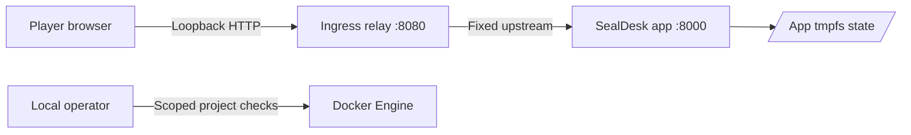

# Security report

**SealDesk · Local training-lab assessment · Updated 25 October 2026**

> **Classification:** Intentional local cryptographic oracle. The response discrepancy maps to CWE-203, Observable Discrepancy.[6] This report assesses a synthetic training lab, not a production service.

## Executive summary

SealDesk intentionally decrypts an attacker-controlled AES-CBC receipt and checks PKCS#7 padding before verifying its HMAC. The receipt endpoint returns `damaged_envelope` for invalid padding and `untrusted_envelope` for padding-valid but unauthenticated input. That difference enables a deterministic, timing-independent padding oracle. The endpoint does not return plaintext, keys, access code, or flag.

The separate document-open endpoint accepts only the fixed document reference and the exact server-held access code. The intended solve recovers that code from the receipt and then uses the normal document workflow. No unrelated vulnerability is intended.

No CVSS score is assigned. This is an isolated exercise with fictional data, not an assessed deployment. The intentional weakness does not mean AES or HMAC is broken.

## Scope and threat model

| Element | Assumption or capability | Boundary and consequence |
|---|---|---|
| Target | Local SealDesk HTTP application reached through the ingress relay at `127.0.0.1:8080`. | Assessment covers the lab services and documented local lifecycle. |
| Attacker | A player can submit bounded JSON receipt requests and observe HTTP results. | Attacker can alter IV and block-aligned ciphertext but cannot select a relay destination. |
| Observable behavior | Status and response class distinguish invalid padding from later HMAC rejection. | The difference is the intended oracle. No timing classification is required. |
| Protected values | Runtime keys, access code, flag, and fictional document for `CASE-4107`. | The receipt is public at the workbench and `GET /case`, but responses disclose no decrypted bytes. Document access requires the exact server-side code. |
| Trust boundary | Host operator controls Docker and local files. Players control only HTTP input within the challenge. | Host Docker control, kernel, and operator materials are outside the player threat model. |
| Excluded targets | Other hosts, external services, unrelated OpenLabs infrastructure, and production systems. | No external target or real record is in scope. |
| Source visibility | Application source, solver, and operator helpers are present in the repository. | A checkout does not technically prevent source inspection or provide source-blind calibration. |

CWE-203 describes a product that behaves differently or sends different responses in observable circumstances.[6] Here the response difference is deliberately limited to the challenge oracle. It is a logical response discrepancy, not a timing side channel.

The player README says source, solver, and operator materials are out of scope. That statement does not technically prevent inspection in a repository checkout. A source-blind difficulty assessment requires a separate service-only distribution.

## Architecture and trust boundary

| Path | Implementation | Trust consequence |
|---|---|---|
| Browser to ingress | Ingress publishes only `127.0.0.1:8080`. | Service is local to the host unless the host forwards it. |
| Ingress to app | Asyncio relay forwards to the fixed upstream `sealdesk:8000`. | Client input cannot choose a destination. The relay does not inspect HTTP. |
| App to state | State is stored under `/run/sealdesk` on app tmpfs. | State is not persisted in the image or a host volume. |
| App network | App joins only internal bridge network `sealdesk_default`. | The app has no external route through its Compose network. |
| Operator to project | Reset and sync helpers validate local project identity and controls. | Helpers are privileged operator tools, not player routes. |

Compose has two services. `sealdesk` runs Flask and Gunicorn on port `8000`. It attaches only to internal bridge network `sealdesk_default` and publishes no port. `ingress` is a stateless asyncio TCP relay with a fixed upstream at `sealdesk:8000`, a 64-connection semaphore, a 3-second connect timeout, and a 30-second idle timeout. It joins `sealdesk_default` and normal bridge network `sealdesk_ingress`. Ingress alone publishes `127.0.0.1:8080:8000`.

Both services run as `10001:10001` with read-only root filesystems, all capabilities dropped, `no-new-privileges`, an init process, bounded tmpfs, and PID, memory, CPU, and log limits. The app's network is internal. Runtime keys, access code, flag, and generation identifier are stored under `/run/sealdesk` on app tmpfs. State is written with mode `0600` and owner `10001`. Only the flag digest is synchronized into `lab.yml` for local checking.

The relay's bridge attachment enables host port publication. It is not an application-layer filter. The host mapping is loopback-only. These controls reduce exposure. They do not guarantee isolation from Docker Engine, host, or kernel vulnerabilities.

## Finding SD-CBC-01

| Property | Detail |
|---|---|
| Status | Intentional challenge behavior |
| Affected route | `POST /api/receipts/check` |
| Root cause | AES-CBC decryption and PKCS#7 unpadding occur before HMAC verification. |
| Observable classes | Invalid padding returns `422` with `damaged_envelope`. Valid padding followed by invalid HMAC returns `422` with `untrusted_envelope`. |
| Positive control | An authentic receipt returns `200` with `valid_receipt`. The response contains no plaintext. |
| Impact in the lab | A player can distinguish padding validity and recover the code-bearing plaintext bytes. |
| Production impact if copied | Sensitive CBC plaintext may be recovered through chosen-ciphertext queries. |
| CWE | CWE-203, Observable Discrepancy; CWE-209, Generation of Error Message Containing Sensitive Information.[2][6] |
| Remediation | Verify the MAC before decryption or use authenticated encryption that releases plaintext only on successful authentication.[1][3][4] |

The route checks bounded receipt framing before cryptographic work. It accepts canonical unpadded Base64URL fields, an exact version, a 16-byte IV, non-empty block-aligned ciphertext within the configured limit, and a 32-byte tag. Malformed JSON or receipt framing returns `400` with `invalid_receipt`. Requests above the `8 KiB` body limit return `413`. These format and size checks do not expose the intended padding result.

## Containment controls

| Control | Implementation | Boundary or residual risk |
|---|---|---|
| Loopback-only ingress publication | Ingress binds `127.0.0.1:8080`. | Host forwarding or Docker control is outside the player threat model. |
| Internal app network | App joins only `sealdesk_default`; no app port is published. | The ingress service remains on a normal bridge for publication. |
| Fixed-upstream relay | Relay connects only to `sealdesk:8000`; client cannot set the destination. | Relay does not inspect application requests or authenticate clients. |
| Non-root, read-only services | Both services run as `10001:10001`, with read-only root, all capabilities dropped, and `no-new-privileges`. | These controls do not mitigate host or kernel vulnerabilities. |
| Ephemeral app state | Keys, code, flag, receipt, and generation identifier live on app tmpfs. | Reset, an app container stop or restart, or recreation creates a new instance. |
| Bounded state permissions | State file is written mode `0600` and owned by `10001`. | This is an in-container access control, not host isolation. |
| Request limits and canonical parsing | Exact receipt fields, canonical encodings, bounded ciphertext, and an `8 KiB` request limit are enforced. | The intentional oracle runs after framing validation. |
| Scoped operator helpers | Helpers check project identity, service identities, networks, mounts, ports, and hardening before reset or digest sync. | A privileged local Docker operator remains trusted. |
| Restricted test container | Test run uses no network, read-only root, dropped capabilities, no-new-privileges, non-root identity, and bounded resources. | Test-container settings do not imply equivalent isolation for arbitrary host workloads. |
| Local flag digest | Only the flag digest is synchronized into `lab.yml`. | The committed `lab.yml` retains the last synchronized digest by owner decision. Do not include plaintext flags, access codes, keys, or full runtime state in evidence. |

The relay attaches to a published bridge network but binds only to the loopback host address and connects only to its fixed app upstream. These controls are scoped containment, not a general guarantee against Docker host or kernel vulnerabilities.

## Negative tests and limitations

| Probe or test class | Observed result | Coverage limit |
|---|---|---|
| Authentic receipt | `200` with `valid_receipt`; no plaintext returned. | Confirms the normal envelope path, not cryptographic strength. |
| Invalid padding | `422` with `damaged_envelope`. | This response is intentionally distinguishable. |
| Valid padding and invalid HMAC | `422` with `untrusted_envelope`. | Confirms the intentional oracle class; no timing test is required. |
| Malformed JSON and receipt framing | Bounded `400` response; no decrypted bytes returned. | Does not exhaust every HTTP parser behavior. |
| Oversized request | Rejected at the configured body limit with `413`. | Does not establish behavior under general resource exhaustion. |
| Document-open validation | Wrong code, identifier, or request shape is rejected; correct code is checked separately from receipt status. | Tests do not establish a production authorization system. |
| Runtime state and reset | Tampered state, stale checker digest, and foreign project identity are rejected by tests or operator guards. | Local test coverage is not a Docker Engine security assessment. |
| Application suite | 41 tests passed in the documented restricted test container. | Unit coverage does not replace the live lifecycle or independent review. |
| Live lifecycle | A 25-gate run covered solve, wrong-value rejection, reset rotation, and selected runtime controls. | One local stack run; not hosted CI. |
| Browser behavior | Valid, damaged, untrusted, invalid-JSON, and wrong-code messages were checked. Input was retained and no horizontal overflow was found at `390` px. | Observed in an interactive browser check on 24 October 2026. No screenshot or log was retained. |
| Read-only source review | No unintended security or logic issues were reported in the inspected source. One relay connection-limit behavior was noted below. | Read-only source review is not dynamic testing or maintainer review. |

The challenge author reported on 25 October 2026 that a fresh start from the player README, flag-digest sync, a solve with the final flag accepted by the checker, and reset with the old flag rejected all passed. No ambiguities or unintended paths were reported. The author approved difficulty `medium`. This was an author-run playtest, not an independent playtest or independent difficulty calibration.

The relay has 64 forwarding slots. Connections beyond those slots are accepted and closed after a 50 ms wait for a slot. A local connection burst can briefly hold additional sockets. The relay's PID, memory, and CPU limits constrain container resource use. The source review identified this as a relay limitation, not a separate vulnerability finding.

No image vulnerability scan is recorded. Container controls do not guarantee isolation from Docker Engine or host-kernel vulnerabilities. Hosted CI and maintainer review remain pending.

## Reporting and handling

Keep runtime secrets and raw private evidence out of public documentation and issue reports. Do not report the documented padding oracle as an accidental infrastructure flaw. Report any separate OpenLabs or toolchain vulnerability through the repository's private security-reporting channel.

For secure-state guidance, see the [remediation guide](./remediation.mdx). For runtime scope and reset behavior, see the [operations runbook](./operations.mdx).

## Sources

[1] https://owasp.org/www-project-web-security-testing-guide/stable/4-Web_Application_Security_Testing/09-Testing_for_Weak_Cryptography/02-Testing_for_Padding_Oracle (OWASP Web Security Testing Guide: Testing for Padding Oracle)
[2] https://cwe.mitre.org/data/definitions/209.html (CWE-209: Generation of Error Message Containing Sensitive Information)
[3] https://csrc.nist.gov/pubs/sp/800/38/d/final (NIST SP 800-38D: GCM and GMAC)
[4] https://www.rfc-editor.org/rfc/rfc5116.html (RFC 5116: An Interface and Algorithms for Authenticated Encryption)
[6] https://web.archive.org/web/20260925013739/https://cwe.mitre.org/data/definitions/203.html (CWE-203: Observable Discrepancy, Wayback snapshot, 2026-09-25)
