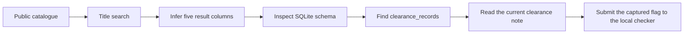
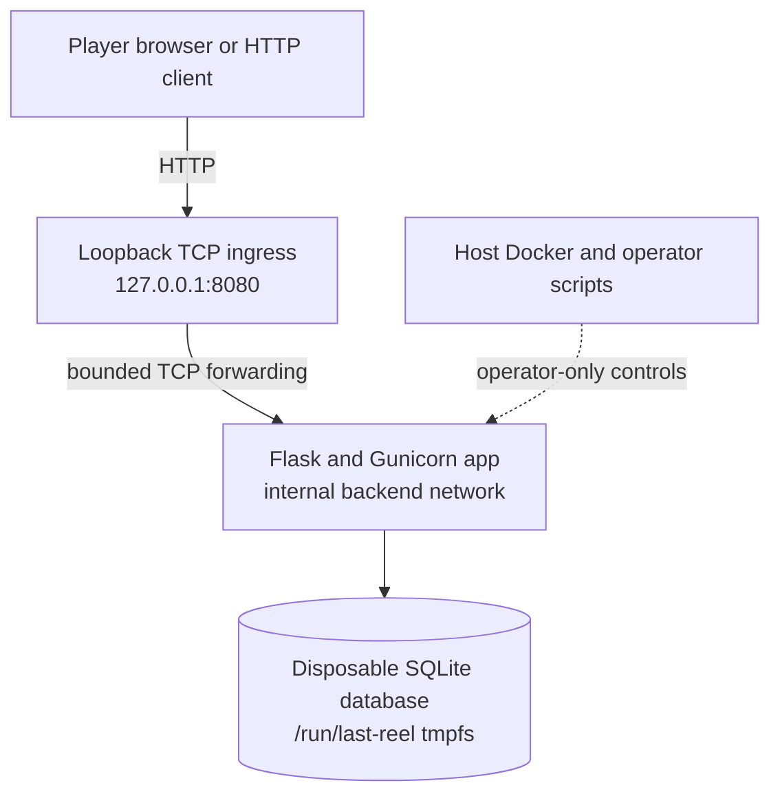

  <strong>Created by Ziad Osama El-Boshy</strong> 
  Challenge author and creator

# Challenge design

**Last Reel · Designer and evaluator edition · Updated 12 October 2026**

> **Current state:** The easy Web challenge is complete and ready for submission as an `experimental` lab. A clean build, the 31-test application suite, the live solve, check, and reset chain, and an independent playtest pass. See the [validation report](validation-report.mdx) for dated evidence and limits.

[Design brief](#design-brief) · [Player journey](#player-journey) · [Architecture](#architecture-and-trust-boundaries) · [Implementation contract](#implementation-contract) · [Difficulty and decisions](#difficulty-and-design-decisions)

## Design brief

| Attribute | Decision |
|---|---|
| Scenario | Anonymous catalogue for a fictional film-restoration archive |
| Track and difficulty | Web · Easy |
| Primary weakness | CWE-89, SQL injection in a title-search predicate |
| Entry point | Public catalogue at `/`, then `GET /search?q=...` |
| Required skills | Basic HTTP, five-column `UNION` reasoning, SQLite schema discovery |
| Completion proof | One runtime-generated `duck{` plus 32 lowercase hexadecimal characters in a restricted clearance note |
| Intended player environment | One local Docker lab, reached through loopback port `8080` |
| Intended data | Fictional catalogue and release-clearance records only |

## Learning objective and story

The archive publishes catalogue metadata for restored films. A restoration awaiting approval has a separate restricted release-clearance record. The player uses the ordinary title search to understand its result shape, discovers the local SQLite schema, and reads that record. The learning objective is narrow: SQL syntax assembled from untrusted input is executable query structure, even when the intended operation is a read-only catalogue search.

The catalogue contains eight public film records and one unpublished record. The runtime flag is not stored in either film row. Startup creates a separate `clearance_records` row whose note holds the current flag.

## Player journey

The path is one vulnerability with a small enumeration step, not a multi-system chain. The brief points to public search without disclosing a payload, table name, or column name.

## Architecture and trust boundaries

| Component or boundary | Intended behavior | Deliberate exception |
|---|---|---|
| Player to ingress | Local HTTP through the single published loopback endpoint | None; do not publish beyond loopback |
| Ingress to application | Forward bounded TCP connections on the private backend network | Ingress does not authenticate HTTP or inspect application requests |
| Application to SQLite | Read public catalogue rows for normal requests | Search syntax permits bounded reads from the local schema and clearance table |
| Operator to runtime | Host scripts may recreate only the `last-reel` Compose project and read digest metadata | Operator controls and host files are not player routes or challenge assets |

The app has no account system, upload, external callback, shell route, or auxiliary API. Detail lookup is a separate parameterized query and returns only public film IDs.

## Implementation contract

| Surface | Behavior |
|---|---|
| `GET /` | Render the eight public records and the title-search form |
| `GET /search?q=...` | Perform the intentionally vulnerable title search; reject unknown or duplicate query keys, oversized query strings, NUL input, and queries beyond the application limit |
| `GET /films/<int:film_id>` | Return a public film record only; bind the ID as a SQLite parameter |
| `GET /health` | Return `{"service":"last-reel","status":"ok"}` after a database readiness query |
| Other paths or unsupported methods | Return a generic application error; do not serve source, database, maintainer docs, solver, or runtime digest files |

The search projection is `id,title,year,synopsis,genre`. The query intentionally concatenates the bounded `q` string into a SQLite `LIKE` expression. The database layer opens the database read-only, enables `query_only`, disables extension loading, installs a SQLite authorizer, restricts reads/functions, limits SQL resources and result size, and interrupts expensive statements. These controls constrain the training surface. They do not make SQL concatenation safe.

The app sets a restrictive same-origin content-security policy, `nosniff`, `no-store`, and `no-referrer`. The frontend uses server-rendered Jinja, local CSS, and native GET forms and links. Search results omit the homepage hero. Public film cards are single links with title-derived accessible names. Detail pages keep a bounded local search query for the return link. Generated or synthetic rows do not become public detail links. There is no JavaScript or external asset dependency.

## Runtime state and reset

At startup, `app/seed.py` creates a random 32-hex-character flag and generation ID, seeds the archive, writes the flag only into the separate clearance note, and stores only its SHA-256 digest plus generation ID in `digest.json`. The database and digest file live under `/run/last-reel` tmpfs and have restrictive file modes. The host synchronizer reads digest metadata, updates only `flag_hash` in `lab.yml`, and verifies that the runtime did not change during synchronization. It never reads out the plaintext flag.

`reset.py` uses an operator lock, confirms Compose-resource ownership, stops ingress, recreates the app from existing images without building or pulling, synchronizes the new digest, recreates ingress, and checks loopback health. A reset failure leaves ingress stopped. A successful reset destroys the prior runtime database and invalidates the earlier flag.

## Difficulty and design decisions

The challenge is easy because it has one anonymous entry point, one SQL query, no authentication state, and no multi-system authorization chain. The player still needs to reason about the result projection and inspect SQLite metadata. The design uses Flask, Gunicorn, SQLite, Jinja, and plain HTML/CSS to keep the application small. A separate standard-library ingress provides one loopback-published endpoint while the application remains on an internal network.

The UI preserves the film-archive presentation but does not host or imply playable film files. The release-clearance clue establishes the fictional data boundary without naming the vulnerable table or its columns. No mobile-specific interaction is part of this challenge's acceptance target.

## Guardrails and maintenance

- Keep the title-search SQL injection as the sole intended vulnerability.
- Do not add a write primitive, database attachment, extension loading, file access, command execution, SSRF, authentication bypass, or host/container escape objective.
- Preserve dynamic flag generation and digest-only metadata. Never place a real runtime flag in source, documentation, metadata, logs, or the image.
- Keep the app unpublished directly. Keep ingress bound to `127.0.0.1:8080`; do not add host mounts, privileged mode, extra capabilities, a Docker socket, or persistent flag storage.
- Align `app/db.py`, templates, tests, solver, operations, player instructions, and these design boundaries when changing observable behavior.
- When changing this lab, do not hand-edit shared OpenLabs tests, fixtures, registries, generators, workflows, or wiki sources. Regenerate shared outputs with the repository generators.
