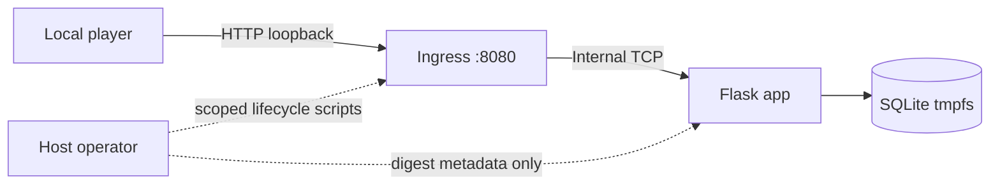

# Security report

**Last Reel · Local training-lab assessment · Updated 12 October 2026**

> **Classification:** Intentionally vulnerable, fictional cybersecurity training application. Use only the supplied local instance. Do not deploy the vulnerable service to the public internet or test the technique against systems without authorization.

## Executive summary

Last Reel contains one intentional SQL-injection flaw in the public title-search parameter. A player can use a five-column SQLite `UNION` to inspect local schema metadata and retrieve the runtime release-clearance note. This is the complete intended impact. No authentication bypass or second vulnerability is required.

This report distinguishes the vulnerable application path from containment controls. Read-only SQLite safeguards reduce the operations available through this path, but they do not make dynamically concatenated SQL safe or prove resistance to every form of sandbox escape.

## Scope and threat model

| Item | Assessment |
|---|---|
| Application | Last Reel Flask/Gunicorn service with SQLite and a separate TCP ingress |
| Player identity | Anonymous user of the local training instance |
| In-scope entry point | `GET /search?q=...` through `http://127.0.0.1:8080` |
| Intended asset | Fictional catalogue metadata and runtime clearance note |
| Intended effect | Bounded read access to the local clearance note and capture of its generated flag |
| Sensitive assets excluded | Host files, Docker daemon, unrelated containers, credentials, external systems, and real personal data |
| Vulnerability identifier | CWE-89, Improper Neutralization of Special Elements used in an SQL Command |
| Severity context | No production CVSS score is assigned. This is an intentionally vulnerable, isolated local exercise. |

The service is anonymous by design. The attacker can submit bounded HTTP search input and observe rendered records. The attacker is not granted host, Docker, database-file, source, or operator-script access through the challenge interface.

## Architecture and trust boundary

The host publishes only `127.0.0.1:8080`, bound to `last-reel-ingress`. Ingress forwards TCP to the application over an internal Docker backend network. The application stores the SQLite database and digest in `/run/last-reel` tmpfs. The host operator uses separate scripts to synchronize the digest and recreate this Compose project.

## Finding LR-SQLI-01

| Property | Detail |
|---|---|
| Affected operation | Title search in `app/db.py` |
| Input | The `q` query parameter |
| Root cause | The value is interpolated into a SQLite `LIKE` SQL string |
| Expected impact | Bounded read access to allowed local tables, including `clearance_records` |
| Not intended | Writes, schema mutation, attachment, extension loading, filesystem access, command execution, SSRF, or host escape |
| Secure-state repair | Parameterized SQL with an explicit `is_public = 1` predicate |

The vulnerable query is bounded and read-only, but a `UNION` changes which rows the statement returns. Read-only access is still a confidentiality failure for the release-clearance table.

## Containment controls

- The application and ingress run as UID/GID `10001`.
- Both services use read-only root filesystems, dropped Linux capabilities, and `no-new-privileges`.
- The app has a `256 MiB` memory limit, one CPU, and a `64`-PID limit. Ingress has a `64 MiB` memory limit, `0.5` CPU, and a `32`-PID limit.
- The app is attached only to an internal backend network. Ingress alone publishes `127.0.0.1:8080`.
- Runtime database and digest state use bounded tmpfs. Compose declares no host or named-volume mounts and no Docker socket.
- SQLite opens in read-only mode for application queries, enables `query_only`, disables extension loading, and installs an authorizer.
- SQL length, result rows, cell length, result bytes, and virtual-machine execution are bounded. Only selected tables and functions are allowed.
- Search failures return a fixed message. The app adds a restrictive content-security policy and other response headers.
- The images and Python requirements are version-pinned; the base image is digest-pinned and package requirements are hash-pinned.

These are reviewed configuration and source controls. They are not a fresh image vulnerability scan or proof of kernel isolation.

## Negative tests and limitations

The local application suite exercises attempted `DELETE`, table creation, `ATTACH`, `PRAGMA writable_schema`, extension loading, oversized values, multiple statements, wrong projection counts, expensive cross joins, excessive result cells, private detail IDs, static traversal, error redaction, and query-string validation. `tests/test_app.py::ApplicationTests.test_intended_search_is_solvable` intentionally confirms that the clearance row is readable through the intended injection. Passing these tests is bounded evidence, not proof against all unintended behavior.

The application, ingress and test-image behavior have not received a current independent security assessment or current image CVE scan. Container controls do not guarantee resistance to vulnerabilities in the host kernel, Docker Engine, or Docker Desktop. Current release gates are tracked in the [validation report](validation-report.mdx).

## Reporting and handling

Do not report the documented search injection as an accidental infrastructure flaw. Report any separate OpenLabs or toolchain vulnerability through the repository's private security-reporting route. Exclude flags, credentials, private client data, and local machine paths from reports and attachments.

For specific root cause, secure implementation, and retest guidance, see the [remediation guide](remediation.mdx). For current execution results and release gates, see the [validation report](validation-report.mdx).
