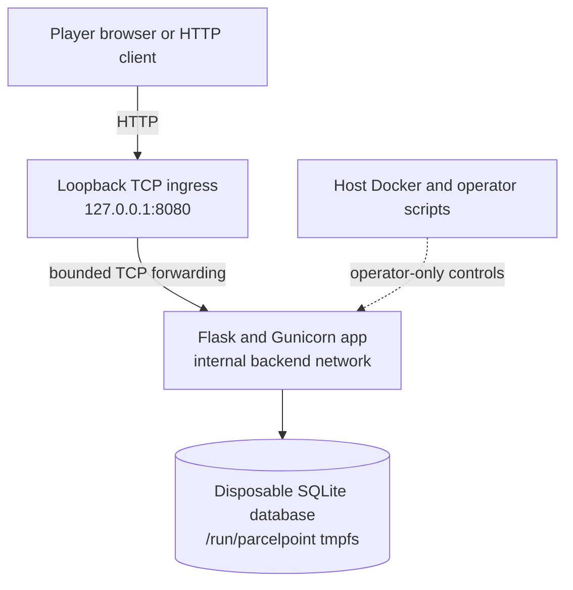

  <strong>Created by Ziad Osama El-Boshy</strong> 
  Challenge author and creator

# Challenge design

**ParcelPoint · Designer and evaluator edition · Updated 17 October 2026**

> **Current state:** The medium Web/API challenge is complete as an `experimental` lab. A clean `--no-cache` build with both Docker builders, the 34-test application suite, the live two-stage solve, check, and reset chain, and the author's README-only playtest pass. See the [validation report](validation-report.mdx) for dated evidence and limits.

[Design brief](#design-brief) · [Player journey](#player-journey) · [Architecture](#architecture-and-trust-boundaries) · [Implementation contract](#implementation-contract) · [Difficulty and decisions](#difficulty-and-design-decisions)

## Design brief

| Attribute | Decision |
|---|---|
| Scenario | Customer and courier console for a fictional smart-locker network |
| Track and difficulty | Web/API · Medium |
| Primary weakness | CWE-640, a password-reset confirmation that does not bind the target account to the reset-code owner |
| Supporting disclosure | The reset mailbox identifies Jules; his authenticated route data identifies Mira as the `PP-407` handoff owner |
| Entry point | Browser console at `/`; the homepage advertises the public API description with an HTTP `Link` header |
| Required skills | HTTP headers and JSON APIs, bearer sessions, OpenAPI reading, identity and authorization analysis |
| Completion proof | A checkpoint flag and a final flag, each `duck{` plus 32 lowercase hexadecimal characters, generated at runtime |
| Intended player environment | One local Docker lab, reached through loopback port `8080` |
| Intended data | Fictional lockers, couriers, routes, reset messages, and one parcel manifest only |

## Learning objective and story

ParcelPoint runs public locker banks and a courier dispatch service. A dispatch review has paused the release of one parcel, held in locker `PP-407`. Customers can register, sign in, and request a password reset through a synthetic mailbox. Couriers see their assigned routes and can request the manifest for a held parcel.

The learning objective is identity binding in account recovery. A code issued for one account must never authorize a password change on another. A secure flow records the target account in a server-side recovery transaction and derives the update target from that record. ParcelPoint instead checks that the code belongs to the signed-in customer, then uses a separate email from the confirmation body to choose the account whose password changes.

Initialization creates two couriers on two routes and eight lockers. The held locker `PP-407` is assigned to Mira Vale. Jules Reed owns a different route; its courier-only handoff note names Mira and her fictional `.test` address. A customer's reset mailbox also contains the dispatch contact for Jules. Public locker details do not reveal either courier's email.

## Player journey

```mermaid
flowchart LR
  A[Public locker console] --> B[Find the held PP-407 locker]
  B --> C[Inspect homepage Link header]
  C --> D[Read the public OpenAPI description]
  D --> E[Register a customer and request a reset]
  E --> F[Read Jules's contact in the mailbox]
  F --> G[Change the hidden request target to Jules]
  G --> H[Sign in as Jules and read checkpoint]
  H --> I[Read his courier-only handoff to Mira]
  I --> J[Reset the target to Mira]
  J --> K[Sign in as Mira and release PP-407]
```

The path chains HTTP service discovery, a controlled customer account, the reset flow, and courier-only operations. The API explorer is not shown in the browser, and the player README does not link directly to the schema. The `service-desc` relation on the homepage provides a standards-based discovery path without hiding or protecting the public document. The reset-confirm request submits the signed-in user's email as an ordinary JSON property, but the confirmation form has no editable email control. A player must inspect the request, identify the target field, then follow the deterministic Jules-to-Mira handoff. Neither courier's address appears in the public locker details.

## Architecture and trust boundaries

| Component or boundary | Intended behavior | Deliberate exception |
|---|---|---|
| Player to ingress | Local HTTP through the single published loopback endpoint | None; do not publish beyond loopback |
| Ingress to application | Forward bounded TCP connections on the private backend network | Ingress does not authenticate HTTP or inspect application requests |
| Customer session | A bearer token authorizes the account's own profile, mailbox, and reset request | Reset confirmation changes the body-selected account |
| Courier session | Role, route assignment, and held status are checked server-side | None; these checks stay active after the intended recovery |
| Application to SQLite | Bound-parameter queries on a database inside the app container; no database listener | None |
| Operator to runtime | Host scripts may recreate only the `parcelpoint` Compose project and read digest metadata | Operator controls and host files are not player routes or challenge assets |

The app has no upload, file-read route, external callback, shell route, or administrative API. The browser is a client of the same API, not a privileged alternate path.

## Implementation contract

| Surface | Behavior |
|---|---|
| `GET /` | Render the locker console, account forms, mailbox, and courier workspace; advertise the public OpenAPI document with `Link: </api/openapi.json>; rel="service-desc"` |
| `GET /api/lockers` | List synthetic locker status; public |
| `GET /api/lockers/<id>` | Return public locker details and events without courier contact fields |
| `POST /api/auth/register` | Create a customer only; name 1–80 characters, password 10–128, email at most 254 characters in the `.test` domain |
| `POST /api/auth/login` | Issue an eight-hour bearer session; invalid credentials share a generic `401` |
| `POST /api/auth/logout` | Revoke the presented session; no request body |
| `GET /api/me` | Return the current account's public fields |
| `POST /api/auth/reset/request` | Issue a code for the caller's own email only; the code expires after ten minutes. Its mailbox message also identifies Jules as the `PP-407` dispatch contact. |
| `GET /api/mailbox` | Return only the caller's synthetic mailbox; query parameters are rejected |
| `POST /api/auth/reset/confirm` | Accept the body-selected account email, a 1–128 character code, and a new password; intentionally changes that account when the caller's code is valid. The browser derives the submitted email from the signed-in user and shows no email field. |
| `GET /api/courier/dashboard` | Courier only; return the dispatch summary and checkpoint flag |
| `GET /api/courier/routes` | Courier only; return the caller's assigned routes, lockers, and any dispatch handoff note |
| `POST /api/courier/lockers/<id>/open` | Courier only; require `{}`, assignment, and `held` status; return the manifest and final flag |
| `GET /api/openapi.json` | Publicly describe every API operation and request shape; contains no flags, codes, passwords, or tokens |
| `GET /health` | Return `{"service":"parcelpoint","status":"ok"}` after a database readiness query |

Request bodies must be JSON objects with exactly the documented keys. Unexpected fields, malformed JSON, unsupported media types, bodies over `8 KiB`, unknown paths, and unsupported methods return a JSON error. SQL statements bind every input value as a parameter.

The reset verifier is stored as a hash and is single-use. The raw code also appears in the addressed synthetic mailbox message so the lab stays self-contained; that message includes Jules's dispatch-contact clue. The confirmation handler looks up the selected account before consuming the code. An unregistered target returns `404` with `This email is not registered.` and leaves the code valid, so a typo can be corrected. A successful change revokes the target account's sessions. The manifest request does not persist a release: `PP-407` stays `held` until reset.

The app sets a restrictive same-origin content-security policy, `nosniff`, `no-store`, and `no-referrer`. The frontend uses local assets only, renders API strings as text nodes, and keeps the bearer token in `sessionStorage`. It provides labelled controls, status announcements, visible keyboard focus, responsive layouts, and reduced-motion handling. Browser input limits match the API limits. The reset confirmation form exposes only the code and new-password controls; its ordinary `email` property comes from the signed-in profile. The API explorer is absent, while the public schema remains discoverable through the homepage response header. There is no hard-coded target address, flag, or solve button in the browser client.

## Runtime state and reset

At startup, `app/seed.py` creates two random 32-hex-character flags and a generation ID, seeds the fixtures, and generates courier passwords that are stored only as Werkzeug hashes. The plaintext flags are stored only in the runtime database and returned only by the intended authenticated operations. `digest.json` holds the generation ID and both SHA-256 digests. The database and digest file live under `/run/parcelpoint` on a `16 MiB` tmpfs, with a mode-`0700` directory and mode-`0600` files. The host synchronizer reads digest metadata, updates `flag_hash` and `checkpoint_flag_hash` in `lab.yml`, and never reads a plaintext flag.

`reset.py` uses an operator lock, confirms Compose-resource ownership, stops ingress, recreates the app from existing images without building or pulling, checks that the generation and both digests changed, synchronizes the new digests, recreates ingress, and checks loopback health. A reset failure leaves ingress stopped. A successful reset destroys accounts, sessions, mailbox rows, reset codes, and both earlier flags.

## Difficulty and design decisions

The challenge is medium because the player must discover the service description from an HTTP response header, inspect a hidden-from-form request property, and complete a deterministic two-account pivot. Jules exposes the checkpoint and a courier-only handoff note; Mira owns the held locker and final release. No brute force, timing attack, custom compiled tool, or external service is required.

The design uses Flask, Gunicorn, SQLite, and plain HTML, CSS, and JavaScript to keep the application small. A separate standard-library ingress provides one loopback-published endpoint while the application remains on an internal network. The synthetic mailbox replaces real email. Returning a recoverable `404` for an unregistered target keeps an ordinary typo from consuming the code, at the cost of account enumeration; the [security report](security-report.mdx) records that tradeoff. Registration and reset requests are not rate-limited because this local lab is not a public multi-tenant service.

## Guardrails and maintenance

- Keep the reset target-binding failure as the sole intended vulnerability. Treat the mailbox and courier route notes as clue-bearing application data, not additional vulnerabilities.
- Preserve customer-only registration, courier role checks, assignment checks, held-status checks, session revocation, reset-code expiry, and single-use consumption.
- Do not add a direct flag route, credential oracle, injection sink, upload, file-read route, command execution, SSRF, or host/container escape objective.
- Preserve dynamic flag generation and digest-only metadata. Never place a runtime flag in source, documentation, metadata, logs, or the image.
- Keep the app unpublished directly. Keep ingress bound to `127.0.0.1:8080`; do not add host mounts, privileged mode, extra capabilities, a Docker socket, or persistent flag storage.
- Align source, OpenAPI, browser limits, tests, solver, operations, player instructions, and these design boundaries when changing observable behavior.
- When changing this lab, do not hand-edit shared OpenLabs tests, fixtures, registries, generators, workflows, or wiki sources. Regenerate shared outputs with the repository generators.
