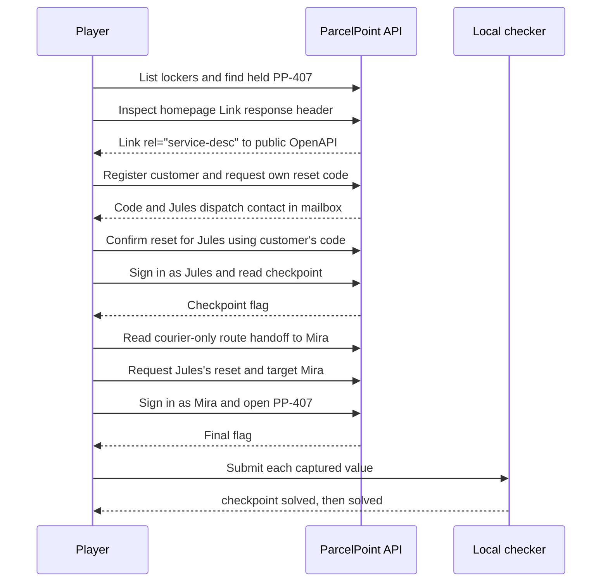

# Official solution

**ParcelPoint · Evaluator edition · Updated 17 October 2026**

> **Spoilers:** This document gives the intended account-recovery flaw, the courier target, and the full two-stage path. Do not provide it during a player-only acceptance exercise. Both flags are generated at runtime and are intentionally not recorded here.

## Intended path at a glance



## Prerequisites

Start the local lab as described in the [operations runbook](operations.mdx) and synchronize the checker digests. Confirm `http://127.0.0.1:8080/health` is healthy. Start from a fresh instance if another evaluator may have used it. The browser console and any HTTP client can perform every step; the requests below use the API directly.

## 1. Discover the API and held locker

Request `GET /api/lockers` and note that `PP-407` is held. The public locker detail has no courier contact field. Inspect the response headers for `GET /`; its `Link` header advertises `/api/openapi.json` with `rel="service-desc"`. Fetch that public document and inspect the request schema for `POST /api/auth/reset/confirm`.

## 2. Obtain the customer's reset code and Jules's contact

Register an ordinary customer with `POST /api/auth/register` and keep the returned bearer token. Call `POST /api/auth/reset/request` with that customer's own email. Read the code and dispatch-contact message from `GET /api/mailbox`; it is available only in that account's synthetic mailbox. The reset message identifies Jules Reed and his fictional `.test` address.

## 3. Reset Jules's password

The browser reset-confirm form has no email input, but its JSON request includes the signed-in customer's email. Use the `email` property described by OpenAPI as the account whose password is updated. Send `POST /api/auth/reset/confirm` with the customer's bearer token, the customer's code, a new password, and Jules's address as `email`. The response is `Password updated.` The code belongs to the authenticated customer, while the handler uses the request email to select Jules's account.

## 4. Read the checkpoint and follow Jules's handoff

Sign in as Jules using `POST /api/auth/login`. Call `GET /api/courier/dashboard` with his token. The response contains the checkpoint flag. `GET /api/courier/routes` returns Jules's assigned routes and a dispatch note naming Mira Vale, her address, and the `PP-407` handoff. Jules does not own that held locker.

## 5. Reset Mira's password

As Jules, request a reset for his own account and read its code from his mailbox. Confirm the reset with Jules's bearer token, that code, a new password, and Mira's address in the `email` property. Sign in as Mira using the new password. Her authenticated routes include the held `PP-407` locker.

## 6. Release the held manifest

Send an empty JSON object to `POST /api/courier/lockers/PP-407/open` with Mira's token. The response contains the held manifest and final flag. Capture both values locally. Do not put them in a ticket, screenshot, saved log, documentation edit, or other shared artifact.

## 7. Check the flags

From the lab directory, run the repository checker once for each captured value:

```text
python ../../../scripts/check.py .
```

Enter the value at the prompt. The checker compares its SHA-256 digest with `checkpoint_flag_hash` and `flag_hash` in this local `lab.yml`. The checkpoint prints `checkpoint solved` and the final flag prints `solved`, each exiting `0`. A mismatch prints `not solved` and exits `1`. The checker does not send the value to the app.

Resetting the instance rotates both flags and updates the local digests. Previously captured flags then fail. See [operations](operations.mdx#reset-and-cleanup).

## Evaluator automation

From the lab directory, after synchronizing the digests:

```text
python solver/solve.py --url http://127.0.0.1:8080
```

The solver performs the same path over local HTTP and passes each captured value to the repository checker in memory. It prints only `Solve complete. The local checker accepted both challenge stages.` and never prints a flag. It accepts only an HTTP loopback origin, does not follow redirects, bounds response size, and runs no Docker command or external-network request.

`tests/test_solver.py` runs a full in-process solve over the real HTTP interface and rejects non-loopback targets. Live solve, check, and reset results are recorded in the [validation report](validation-report.mdx).

## Why the reset works

`POST /api/auth/reset/request` stores a hashed verifier tied to the authenticated user's ID and writes the raw code to that user's mailbox. During confirmation, `app/__init__.py` checks the code against the current user's ID but never requires the body's `email` to identify that same user. It then updates the account selected by that email and deletes the target's sessions. The first takeover recovers Jules and the checkpoint; Jules's courier-only route note identifies Mira, who owns `PP-407`. A second reset recovers Mira, while the role, assignment, and held-status checks on courier routes remain in force.

If the target email does not exist, the endpoint returns `404` with `This email is not registered.` before consuming the code, so a typo can be corrected. That response also reveals whether an account exists; the [security report](security-report.mdx) records the tradeoff.
