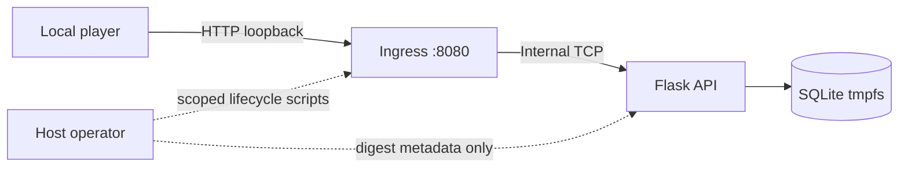

# Security report

**ParcelPoint · Local training-lab assessment · Updated 17 October 2026**

> **Classification:** Intentionally vulnerable, fictional cybersecurity training application. Use only the supplied local instance. Do not deploy the vulnerable service to the public internet or test the technique against systems without authorization.

## Executive summary

ParcelPoint contains one intentional account-recovery flaw. Password-reset confirmation verifies a code owned by the signed-in account, then changes the password of the account named in the request body. The deterministic exercise uses that flaw twice: a customer resets Jules, whose courier-only route note identifies Mira; a reset as Jules then recovers Mira, who owns held locker `PP-407`. The checkpoint and final flags are returned only by their intended courier operations.

This report distinguishes the vulnerable recovery path from the authorization and containment controls that stay in force. Those controls bound the exercise; they do not make the recovery design safe or prove resistance to every form of container escape.

## Scope and threat model

| Item | Assessment |
|---|---|
| Application | ParcelPoint Flask/Gunicorn API and browser console with SQLite and a separate TCP ingress |
| Player identity | Self-registered customer of the local training instance |
| In-scope entry points | The browser console and `/api/*` through `http://127.0.0.1:8080` |
| Intended assets | Synthetic locker, courier, and manifest data, and the two runtime flags |
| Intended effect | Two courier account takeovers through reset confirmation, then the checkpoint from Jules and the `PP-407` manifest from Mira |
| Sensitive assets excluded | Host files, Docker daemon, unrelated containers, credentials, external systems, and real personal data |
| Vulnerability identifier | CWE-640, Weak Password Recovery Mechanism for Forgotten Password |
| Severity context | No production CVSS score is assigned. This is an intentionally vulnerable, isolated local exercise. In a real service the same flaw would be critical. |

The player can register customers, send bounded JSON requests, and read responses. The player is not granted host, Docker, database-file, source, or operator-script access through the challenge interface.

## Architecture and trust boundary

The host publishes only `127.0.0.1:8080`, bound to `parcelpoint-ingress`. Ingress forwards TCP to the application over an internal Docker backend network. The application stores the SQLite database and digest in `/run/parcelpoint` tmpfs. The host operator uses separate scripts to synchronize the digests and recreate this Compose project.

## Finding PP-RESET-01

| Property | Detail |
|---|---|
| Affected operation | `POST /api/auth/reset/confirm` in `app/__init__.py` |
| Input | The `email` field of the confirmation body |
| Root cause | The verified code owner and the updated account are chosen independently; the target comes from client input |
| Supporting disclosure | The customer reset message identifies Jules; Jules's courier-only route note identifies Mira and the `PP-407` handoff |
| Expected impact | Password change and sign-in for any registered account, including either courier |
| Not intended | Role escalation at registration, cross-account mailbox reads, access to another courier's locker, injection, file access, command execution, SSRF, or host escape |
| Secure-state repair | Take the update target from the recovery record's owner ID; see the [remediation guide](remediation.mdx) |

The takeover does not bypass courier authorization. Courier routes still check role and route assignment, and locker release checks held status. The player satisfies those checks only by first signing in as Jules and then as Mira.

## Containment controls

- The application and ingress run as UID/GID `10001`.
- Both services use read-only root filesystems, dropped Linux capabilities, and `no-new-privileges`.
- The app has a `256 MiB` memory limit, one CPU, and a `64`-PID limit. Ingress has a `64 MiB` memory limit, `0.5` CPU, a `32`-PID limit, and at most 32 concurrent connections.
- The app is attached only to an internal backend network. Ingress alone publishes `127.0.0.1:8080`.
- Runtime database and digest state use a `16 MiB` tmpfs. Compose declares no host or named-volume mounts and no Docker socket.
- Registration accepts only `name`, `email`, and `password` and always creates a customer. Bearer tokens are random, stored as hashes, expire after eight hours, and are revoked on logout or password change.
- Reset codes are stored as hashes with an owner, a ten-minute expiry, and a used flag, and are consumed once inside the password-update transaction.
- Every SQL value is a bound parameter. Request bodies must match the documented keys, and bodies over `8 KiB` are rejected.
- The API returns JSON errors without tracebacks and adds a restrictive same-origin content-security policy, `nosniff`, `no-store`, and `no-referrer`. The browser renders API data as text nodes.
- The images and Python requirements are version-pinned; the base image is digest-pinned and package requirements are hash-pinned.

These are reviewed configuration and source controls. They are not proof of kernel isolation.

## Negative tests and limitations

The 34-test application suite exercises these boundaries:

| Probe | Expected result |
|---|---|
| Anonymous request to `/api/mailbox` or a courier route | `401` JSON error |
| Customer request to a courier route | `403` JSON error |
| Registration with `role` or another extra field | `400`; only customers are created |
| Email over 254 characters or name over 80 characters | `400` |
| Missing, wrong, expired, or used reset code | `400`; no password changes |
| Valid code with an unregistered target email | `404`; the code stays valid |
| Courier opens a locker assigned to the other courier | `404` |
| Courier opens a locker that is not held | `409` |
| Reset request for another account's email | `400` |
| OpenAPI document | Covers every API route and contains no flag |

The frontend tests reject `innerHTML`, `insertAdjacentHTML`, `eval`, inline event handlers, inline styles, external assets, and solve-button or exploit wording in the client. `tests/test_api.py` intentionally confirms that the body-selected target account changes. Passing these tests is bounded evidence, not proof against all unintended behavior.

Accepted limitations:

- Registration returns `409` for an existing email, and reset confirmation returns `404` for an unregistered target. Both reveal account existence. The `404` keeps a typo from consuming the code.
- Registration, reset requests, and mailbox rows are not rate-limited or pruned. Reset confirmation computes the scrypt password hash before it checks the code, so an authenticated local user can trigger expensive hashing with invalid codes. Container limits and the `16 MiB` state tmpfs bound the effect; no stress test was run.
- The manifest request does not change `PP-407` from `held`, so the assigned courier can read it again until reset. No extra role or account is gained.
- The bearer token is kept in `sessionStorage`, which suits this isolated lab but is not a production recommendation.

The application, ingress, and test image have not received an independent security assessment. A Docker Scout scan of the images found no critical findings and no findings in the Python dependencies; its Debian base-package findings are recorded in the [validation report](validation-report.mdx). Container controls do not guarantee resistance to vulnerabilities in the host kernel, Docker Engine, or Docker Desktop.

## Reporting and handling

Do not report the documented reset-target flaw as an accidental infrastructure weakness. Report any separate OpenLabs or toolchain vulnerability through the repository's [private security-reporting route](https://github.com/duckurity/openlabs/security/advisories/new). Exclude flags, credentials, reset codes, private client data, and local machine paths from reports and attachments.

For specific root cause, secure implementation, and retest guidance, see the [remediation guide](remediation.mdx). For current execution results and release gates, see the [validation report](validation-report.mdx).
